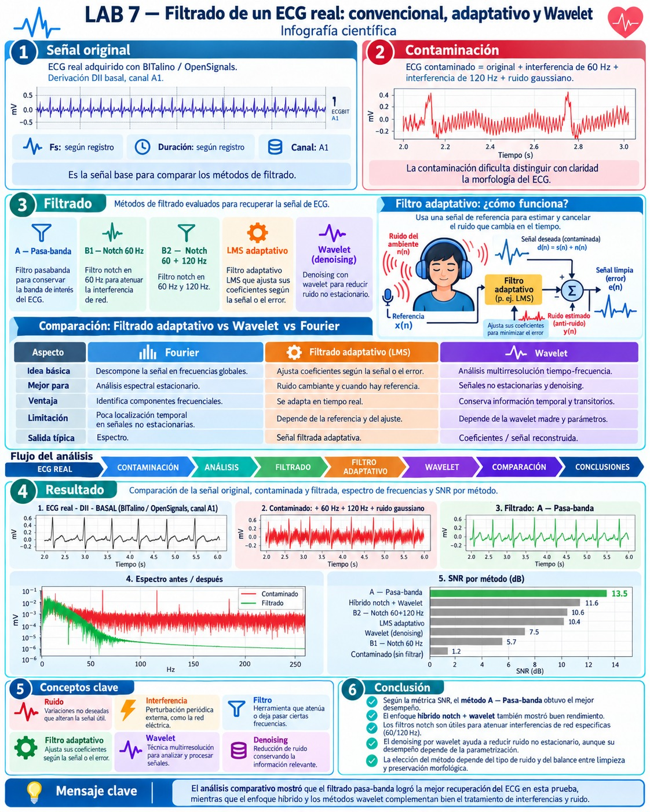

<h1 align="center">Filtrado de señales ECG: filtros convencionales, LMS y Transformada Wavelet</h1>
<p align="center"><em>Laboratorio 7 — Introducción a Señales Biomédicas</em></p>

**Grupo 4 — 2026-II**  
**Integrantes:** Astrid Sophia Mejía Barreto, Geraldine Mayte Segura Villarreal, José Fernando Vera Meza y Solangel Macedo Pereira.  
**Fecha de laboratorio:** 02/10/2026.

## Índice

- [1. Introducción](#1-introducción)
- [2. Materiales y herramientas](#2-materiales-y-herramientas)
- [3. Fundamento teórico del laboratorio](#3-fundamento-teórico-del-laboratorio)
  - [3.1 Adquisición y digitalización del ECG](#31-adquisición-y-digitalización-del-ecg)
  - [3.2 Ruido, interferencias y análisis espectral](#32-ruido-interferencias-y-análisis-espectral)
  - [3.3 Filtros digitales convencionales](#33-filtros-digitales-convencionales)
  - [3.4 Filtrado adaptativo LMS](#34-filtrado-adaptativo-lms)
  - [3.5 Transformada Wavelet y denoising](#35-transformada-wavelet-y-denoising)
  - [3.6 Métricas de evaluación](#36-métricas-de-evaluación)
- [4. Procedimiento experimental](#4-procedimiento-experimental)
- [5. Resultados](#5-resultados)
- [6. Análisis y comparación](#6-análisis-y-comparación)
- [7. Respuestas al cuestionario](#7-respuestas-al-cuestionario)
- [8. Síntesis e infografía](#8-síntesis-e-infografía)
- [9. Conclusiones](#9-conclusiones)
- [10. Referencias](#10-referencias)

# 1. Introducción

Las señales electrocardiográficas (ECG) registran la actividad eléctrica del corazón, pero durante su adquisición pueden incorporar ruido electrónico, interferencia de la red eléctrica y artefactos de movimiento. Estas perturbaciones pueden ocultar las ondas P y T, modificar los complejos QRS y dificultar el análisis de la señal. Por ello, el filtrado debe reducir los componentes no deseados sin alterar innecesariamente la información fisiológica.

En este laboratorio se trabajó con un ECG real registrado mediante **BITalino (r)evolution y OpenSignals**. Primero se examinó la señal original y luego se añadieron artificialmente dos interferencias sinusoidales y ruido gaussiano. Sobre ese registro contaminado se aplicaron filtros **pasa-banda**, **notch**, un cancelador adaptativo **LMS** y métodos basados en **Wavelet**, para comparar su desempeño mediante gráficas y métricas cuantitativas.

**Objetivos:** identificar correctamente el canal ECG y sus parámetros de adquisición; reconocer ruido e interferencias en tiempo y frecuencia; implementar diferentes técnicas de filtrado; y evaluar cuánto ruido se reduce y cuánto se conserva de la morfología del ECG.

# 2. Materiales y herramientas

- Registro ECG `DII_BASAL.txt`, adquirido con BITalino (r)evolution y OpenSignals.
- Google Colab / Jupyter Notebook para la ejecución y documentación del análisis.
- **NumPy** y **Pandas** para el manejo de muestras y datos.
- **Matplotlib** para representar las señales en tiempo y frecuencia.
- **SciPy (`scipy.signal`)** para diseñar y aplicar filtros digitales.
- **PyWavelets (`pywt`)** para la descomposición y reducción de ruido mediante Wavelet.

# 3. Fundamento teórico del laboratorio

## 3.1 Adquisición y digitalización del ECG

El ECG registra diferencias de potencial originadas por la despolarización y repolarización cardíaca. Su morfología comprende la **onda P**, asociada a la despolarización auricular; el **complejo QRS**, asociado a la despolarización ventricular; y la **onda T**, relacionada con la repolarización ventricular.

El archivo de OpenSignals incluye una cabecera con los metadatos y una tabla de muestras. La señal utilizada se encuentra en el canal **A1**, no en `nSeq`: esta última columna contiene un contador cíclico de paquetes que ayuda a detectar posibles pérdidas de datos. El tiempo se construye a partir de la frecuencia de muestreo:

$$
t[n]=\frac{n}{F_s},\qquad T_s=\frac{1}{F_s}
$$

Para pasar del valor del conversor analógico-digital (ADC) a milivoltios, el notebook empleó la relación de transferencia del sensor ECG:

$$
ECG_{mV}=\left(\frac{ADC}{2^{b}}-\frac{1}{2}\right)\frac{V_{CC}}{G_{ECG}}\times1000
$$

Donde $b=10$ bits, $V_{CC}=3.3$ V y $G_{ECG}=1100$. Posteriormente se restó la media para centrar la señal en cero.

| Parámetro | Valor registrado |
|---|---:|
| Derivación y canal | DII, A1 |
| Frecuencia de muestreo | 1000 Hz |
| Periodo de muestreo | 1 ms |
| Resolución | 10 bits (1024 niveles) |
| Número de muestras | 38 550 |
| Duración | 38.55 s |
| Posibles pérdidas detectadas mediante `nSeq` | 0 |

## 3.2 Ruido, interferencias y análisis espectral

El **ruido** es una perturbación no deseada, generalmente aleatoria, que puede abarcar numerosas frecuencias. Una **interferencia** suele presentar una estructura reconocible, como una oscilación periódica causada por la red eléctrica. Ambos componentes pueden dificultar la identificación de las ondas del ECG.

Para comprobar los efectos del filtrado, se sumaron a la señal original dos interferencias sinusoidales de **60 Hz** y **120 Hz** y ruido gaussiano. La contaminación fue **simulada y controlada**: no debe confundirse con todo el ruido presente durante una adquisición real.

$$
ECG_c[n]=ECG_o[n]+i_{60}[n]+i_{120}[n]+r[n]
$$

Las amplitudes de las interferencias se fijaron como proporciones de la desviación estándar del ECG original. Se utilizó una semilla aleatoria de 42 para reproducir las señales generadas.

| Componente añadida | Parámetro del notebook |
|---|---|
| Interferencia de red | 60 Hz; amplitud 0.092 mV |
| Segundo armónico | 120 Hz; amplitud 0.055 mV |
| Ruido gaussiano | Desviación estándar 0.028 mV |

La **Transformada Rápida de Fourier (FFT)** permitió visualizar estas componentes en el dominio frecuencial: las senoides generan picos alrededor de sus frecuencias, mientras que el ruido de banda ancha eleva el fondo del espectro. Este análisis ayuda a decidir qué filtro aplicar.

## 3.3 Filtros digitales convencionales

Los filtros convencionales utilizan coeficientes definidos previamente. En el laboratorio se aplicaron los siguientes:

| Método | Configuración | Propósito |
|---|---|---|
| **Pasa-banda Butterworth** | Orden 4; 0.5–40 Hz | Reducir deriva lenta y componentes de alta frecuencia |
| **Notch 60 Hz** | $Q=30$ | Atenuar la primera interferencia sinusoidal |
| **Notch 60 + 120 Hz** | Dos notch en cascada; $Q=30$ | Atenuar ambas interferencias sinusoidales |

El **pasa-banda** conserva principalmente el intervalo seleccionado, pero también puede reducir componentes verdaderas del ECG fuera de ese rango. Por ejemplo, un corte superior demasiado bajo puede suavizar el QRS y alterar su amplitud.

El **notch** rechaza una región estrecha del espectro alrededor de una frecuencia conocida. Su ancho aproximado depende del factor de calidad:

$$
BW\approx\frac{f_0}{Q}
$$

Un valor bajo de $Q$ produce una muesca más ancha y puede afectar más componentes próximas; un valor alto produce una muesca más estrecha, que requiere mayor precisión en la frecuencia a eliminar. Los filtros se aplicaron con `sosfiltfilt` y `filtfilt`, que procesan la señal hacia adelante y hacia atrás para evitar el desfase, aunque pueden introducir cambios de amplitud y efectos de borde.

## 3.4 Filtrado adaptativo LMS

Un filtro adaptativo modifica sus coeficientes durante el procesamiento para ajustarse a una interferencia. El laboratorio implementó un cancelador basado en el algoritmo **LMS (*Least Mean Squares*)**, que recibe el ECG contaminado y referencias correlacionadas con el ruido que desea estimar.

En este caso, las referencias fueron senos y cosenos de **60 Hz y 120 Hz**, lo que permitió ajustar la amplitud y fase de ambas interferencias. El filtro estima la componente no deseada $y[n]$ y la resta de la entrada $d[n]$:

$$
e[n]=d[n]-y[n]
$$

Los coeficientes se actualizan mediante:

$$
w[n+1]=w[n]+2\mu\,e[n]x[n]
$$

Donde $x[n]$ es el vector de referencias y $\mu$ controla el paso de adaptación. En el notebook se utilizó **$\mu=0.005$**. Un paso demasiado pequeño retrasa la convergencia y uno elevado puede provocar oscilaciones y degradar la señal. Como el ruido gaussiano no está correlacionado con estas referencias, el LMS implementado no está diseñado para eliminarlo.

## 3.5 Transformada Wavelet y *denoising*

La **Transformada Wavelet Discreta (DWT)** permite estudiar componentes de la señal según su escala y localización temporal. Es útil en el ECG porque los complejos QRS son eventos breves, mientras que la línea de base y otras ondas varían más lentamente. A diferencia de una FFT global, la DWT permite observar en qué instantes aparecen determinados detalles.

En el laboratorio se utilizó la wavelet **Daubechies 4 (`db4`)** con **8 niveles de descomposición**. Cada nivel separa componentes de **aproximación (A)**, más lentas, y de **detalle (D)**, más rápidas. De forma aproximada, las interferencias de 120 Hz y 60 Hz se sitúan en las bandas D3 y D4, respectivamente.

Para la reducción de ruido (*Wavelet denoising*) se descompuso la señal, se estimó el ruido a partir de los coeficientes de detalle D1 y se aplicó un umbral universal antes de reconstruirla:

$$
\sigma\approx\frac{\operatorname{mediana}(|D_1|)}{0.6745},\qquad
\lambda=\sigma\sqrt{2\ln(N)}
$$

Se utilizó **umbralización suave (*soft thresholding*)**, que anula coeficientes de pequeña magnitud y reduce los mayores. El umbral calculado fue **0.1289**. Este método puede disminuir el ruido de banda ancha, pero no garantiza retirar senoides intensas, cuyos coeficientes pueden superar el umbral. Por eso también se evaluó una solución **híbrida: notch de 60 y 120 Hz seguido de Wavelet**.

## 3.6 Métricas de evaluación

La calidad del filtrado se evaluó comparando cada señal procesada con el ECG real original, empleado como referencia de este ejercicio. Se excluyeron los **primeros y últimos 2 segundos** para reducir los efectos de borde y el impacto inicial de la adaptación.

| Métrica | Significado | Mejor desempeño |
|---|---|---|
| **RMSE (mV)** | Raíz del error cuadrático medio respecto al ECG de referencia | Menor valor |
| **SNR (dB)** | Relación entre la energía de referencia y la del error | Mayor valor |
| **Correlación de Pearson ($r$)** | Similitud entre las formas de ambas señales | Más cercana a 1 |

$$
RMSE=\sqrt{\frac{1}{N}\sum_{n=1}^{N}(x[n]-\hat x[n])^2}
$$

$$
SNR=10\log_{10}\left(\frac{\sum_n x[n]^2}{\sum_n(x[n]-\hat x[n])^2}\right)
$$

Estas métricas deben interpretarse junto con las gráficas, ya que una señal con menos error global todavía puede presentar cambios importantes en las ondas P, QRS o T.

# 4. Procedimiento experimental

1. **Exploración de datos:** se leyó `DII_BASAL.txt`, se verificaron los metadatos y la continuidad del contador `nSeq`, y se extrajo el ECG de `A1`.
2. **Señal original:** se convirtió la lectura ADC a milivoltios, se centró respecto a cero y se visualizaron el registro completo y una ventana de 4 segundos.
3. **Contaminación:** se sumaron al ECG las senoides de 60 y 120 Hz y ruido gaussiano; posteriormente se compararon sus representaciones temporales y espectrales mediante FFT.
4. **Experimento A:** se aplicó el filtro pasa-banda Butterworth de 0.5–40 Hz.
5. **Experimento B:** se probó un notch de 60 Hz y después dos notch en cascada de 60 y 120 Hz.
6. **Filtrado LMS:** se implementó la adaptación con referencias sinusoidales y paso $\mu=0.005$, observando también la convergencia de los coeficientes.
7. **Wavelet e híbrido:** se descompuso la señal usando `db4`, se aplicó umbralización suave y se comparó con notch seguido de Wavelet.
8. **Evaluación:** se calcularon RMSE, SNR y correlación; finalmente se elaboró una figura base para la infografía.

# 5. Resultados

## 5.1 ECG original y contaminación

El registro original presentó amplitudes entre **−0.326 mV y 0.643 mV**, con una desviación estándar de **0.092 mV**. En una ventana de cuatro segundos se identificaron aproximadamente cinco complejos QRS, lo que permitió estimar una frecuencia cardíaca cercana a **75 lpm** mediante conteo visual.

<p align="center"><br><em>Fig. 1. Ventana de cuatro segundos de la señal ECG original.</em></p>

Al añadir la contaminación, aparecieron oscilaciones que dificultaron especialmente la observación de las ondas de menor amplitud. En la FFT se identificaron componentes localizadas en 60 y 120 Hz y un aumento del fondo espectral.

<p align="center"><br><em>Fig. 2. Comparación temporal entre el ECG original y el contaminado.</em></p>

<p align="center"><br><em>Fig. 3. Espectros del ECG original y contaminado, utilizados para identificar las interferencias.</em></p>

## 5.2 Filtros convencionales

El **pasa-banda de 0.5–40 Hz** redujo las interferencias introducidas y parte del ruido gaussiano de alta frecuencia. El **notch de 60 Hz** eliminó principalmente esa componente, pero dejó la de 120 Hz; al utilizar dos notch en cascada se redujeron ambas frecuencias, aunque permaneció el ruido de banda ancha.

<p align="center"><br><em>Fig. 4. ECG original, contaminado y filtrado mediante pasa-banda.</em></p>

<p align="center"><br><em>Fig. 5. Efecto de aplicar un notch de 60 Hz y dos notch de 60 y 120 Hz.</em></p>

## 5.3 LMS y Wavelet

El LMS estimó progresivamente las interferencias usando las referencias disponibles. Durante los primeros instantes se observó el proceso de convergencia; después, la cancelación redujo las senoides sin eliminar de manera equivalente el ruido gaussiano.

<p align="center"><br><em>Fig. 6. Adaptación de los coeficientes del LMS y salida del filtro durante los primeros segundos.</em></p>

La descomposición Wavelet permitió diferenciar componentes rápidas, transitorios asociados al QRS y variaciones lentas. El *denoising* directo redujo el ruido de banda ancha, mientras que la combinación **notch + Wavelet** permitió abordar primero las interferencias periódicas y luego el ruido residual.

<p align="center"><br><em>Fig. 7. Comparación temporal del pasa-banda, Wavelet y el método híbrido.</em></p>

## 5.4 Comparación cuantitativa

Las siguientes cifras proceden de la tabla final calculada en el notebook, usando la misma referencia ECG y la misma ventana de evaluación:

| Método | RMSE (mV) | SNR (dB) | Correlación $r$ |
|---|---:|---:|---:|
| ECG contaminado, sin filtrar | 0.0803 | 1.2186 | 0.7556 |
| **Pasa-banda 0.5–40 Hz** | **0.0193** | **13.6134** | **0.9780** |
| Notch 60 Hz | 0.0476 | 5.7609 | 0.8888 |
| Notch 60 + 120 Hz | 0.0275 | 10.5407 | 0.9586 |
| LMS adaptativo | 0.0281 | 10.3573 | 0.9577 |
| Wavelet (*denoising*) | 0.0388 | 7.5400 | 0.9077 |
| Híbrido notch + Wavelet | 0.0242 | 11.6570 | 0.9756 |

<p align="center"><br><em>Fig. 8. Comparación de SNR de los métodos evaluados frente al ECG original.</em></p>

# 6. Análisis y comparación

El **pasa-banda** presentó los mejores resultados cuantitativos del ensayo: RMSE de **0.0193 mV**, SNR de **13.61 dB** y correlación de **0.9780**. Respecto al ECG contaminado, la SNR mejoró aproximadamente **12.39 dB**. Esto concuerda con la reducción visual de oscilaciones no deseadas, aunque parte del contenido real del ECG también puede atenuarse por el límite superior de 40 Hz.

Los **notch** mostraron un comportamiento selectivo: uno solo no fue suficiente para eliminar dos interferencias diferentes, pero la cascada logró una SNR de **10.54 dB**. El **LMS** alcanzó **10.36 dB** y permitió observar la ventaja de ajustar sus coeficientes, a costa de requerir una referencia y un intervalo de convergencia.

El **Wavelet denoising** obtuvo **7.54 dB**, ya que la umbralización puede reducir ruido distribuido, pero no necesariamente suprimir senoides intensas. El método **híbrido** mejoró hasta **11.66 dB**, con una correlación de **0.9756**, lo que muestra que combinar técnicas puede ser útil cuando coexisten interferencias de banda estrecha y ruido de banda ancha.

Para identificar cuánto puede distorsionar la señal un filtro, el notebook también aplicó los métodos al **ECG original sin contaminación artificial**. El pasa-banda generó un RMSE de **0.0178 mV**, mientras que los dos notch produjeron **0.0032 mV**. Esto confirma que un filtro puede introducir diferencias aunque no exista el ruido que pretende eliminar.

En consecuencia, **el pasa-banda fue el mejor método según las métricas obtenidas en este experimento**, pero ello no significa que sea superior en todos los escenarios clínicos. La decisión depende de la contaminación presente, la morfología que debe conservarse y si el procesamiento será en tiempo real o fuera de línea.

# 7. Respuestas al cuestionario

**1. ¿Por qué es importante conocer la frecuencia de muestreo de una señal biomédica?**  
Porque permite construir correctamente el eje temporal y conocer el intervalo entre muestras. También determina el rango de frecuencias que puede representarse sin aliasing; por el criterio de Nyquist, la frecuencia de muestreo debe superar el doble de la frecuencia máxima de interés.

**2. ¿Qué diferencia existe entre ruido e interferencia?**  
El ruido suele ser aleatorio y distribuirse en distintas frecuencias, mientras que una interferencia puede tener una estructura definida, como una senoide de 60 Hz. Esta diferencia permite elegir métodos específicos para cada perturbación.

**3. ¿Por qué una interferencia sinusoidal puede observarse como un pico en el dominio de la frecuencia?**  
Porque una senoide concentra su contenido espectral alrededor de una frecuencia determinada. En cambio, el ruido gaussiano de banda ancha se distribuye entre numerosas frecuencias y eleva el fondo del espectro.

**4. ¿Qué sucede cuando aplicamos un filtro demasiado agresivo a una señal ECG?**  
Además de reducir el ruido, puede eliminar componentes fisiológicas. Si se reduce demasiado la frecuencia de corte superior, el QRS puede aparecer suavizado, con menor amplitud y detalles perdidos, afectando su interpretación.

**5. ¿Cuál es la principal diferencia conceptual entre un filtro convencional y un filtro adaptativo?**  
Un filtro convencional utiliza coeficientes establecidos al diseñarlo. El adaptativo modifica sus coeficientes durante el procesamiento según una señal de error, por lo que puede seguir ciertas variaciones de la interferencia si cuenta con una referencia adecuada.

**6. ¿Para qué sirve la Transformada Wavelet?**  
Permite descomponer una señal en componentes de diferentes escalas y estudiar cómo se distribuyen en el tiempo. También puede utilizarse para reducir ruido mediante umbralización y posterior reconstrucción.

**7. ¿Por qué la Transformada Wavelet puede resultar útil para analizar señales biomédicas?**  
Porque las señales biomédicas contienen eventos transitorios, como el complejo QRS, que no se describen completamente con un espectro global. Wavelet permite localizar esos eventos y analizar simultáneamente variaciones rápidas y lentas.

**8. ¿Qué información podría perderse durante el proceso de filtrado?**  
Pueden perderse amplitudes, detalles de las ondas P y T, componentes rápidas del QRS o variaciones lentas de la línea de base. Un filtro excesivo puede generar una señal aparentemente limpia, pero menos fiel al registro original.

**9. Si conoces la frecuencia exacta de una interferencia, ¿qué tipo de filtro podrías utilizar?**  
Se puede utilizar un filtro notch centrado en esa frecuencia. Por ejemplo, para atenuar componentes de 60 y 120 Hz se pueden aplicar dos notch en cascada, cuidando que su ancho de rechazo no afecte innecesariamente al ECG.

**10. ¿Por qué no debemos evaluar un filtro únicamente observando visualmente la señal?**  
Porque una señal más suave no garantiza menor error ni conservación de la morfología. Conviene combinar la inspección del ECG y su espectro con métricas como RMSE, SNR y correlación, considerando las limitaciones de cada medida.

# 8. Síntesis e infografía

La práctica partió de un **ECG real** y permitió estudiar una contaminación simulada con interferencias de 60 y 120 Hz más ruido gaussiano. Se utilizaron herramientas de análisis temporal y espectral, y se compararon filtros convencionales, LMS y Wavelet. El mejor resultado cuantitativo de esta ejecución correspondió al pasa-banda, aunque el método híbrido también mostró una recuperación favorable.

```text
ECG real (BITalino / OpenSignals)
          ↓
Contaminación artificial (60 Hz + 120 Hz + ruido)
          ↓
Análisis temporal y espectral (FFT)
          ↓
Pasa-banda / Notch / LMS / Wavelet / Híbrido
          ↓
Comparación visual + RMSE + SNR + correlación
          ↓
Interpretación de resultados y conclusiones
```

**Infografía presentada por el grupo:**

<p align="center"><br><em>Infografía del Laboratorio 7 (archivo ubicado en la misma carpeta del README).</em></p>

# 9. Conclusiones

El laboratorio permitió comprobar que las perturbaciones pueden dificultar la interpretación del ECG y que cada técnica de filtrado responde de manera distinta según las características del ruido. Los filtros notch redujeron interferencias localizadas, el LMS permitió adaptar la estimación de estas componentes y Wavelet facilitó el análisis temporal por escalas y la atenuación de ruido de banda ancha.

En los datos analizados, el **pasa-banda de 0.5–40 Hz** presentó la mayor SNR (**13.61 dB**) y el menor RMSE (**0.0193 mV**), mientras que el método híbrido obtuvo una SNR de **11.66 dB**. No obstante, el mejor valor de una métrica no garantiza por sí solo la conservación completa de la información fisiológica. Por ello, un procesamiento adecuado debe valorar conjuntamente la reducción de ruido, la morfología de las ondas, la distorsión introducida y el propósito de la aplicación biomédica.

# 10. Referencias

- Universidad Peruana Cayetano Heredia. *Laboratorio 7 — Filtrado de señales II: Filtros adaptativos y Transformada Wavelet aplicados a ECG*. Cuaderno práctico del curso Introducción a Señales Biomédicas, 2026.
- PLUX Wireless Biosignals. *Documentación técnica del sensor ECG de BITalino y del software OpenSignals* (citada para la interpretación de los datos de adquisición y la conversión ADC).
- SciPy. *Signal processing (`scipy.signal`)*. https://docs.scipy.org/doc/scipy/reference/signal.html
- PyWavelets. *PyWavelets documentation*. https://pywavelets.readthedocs.io/

