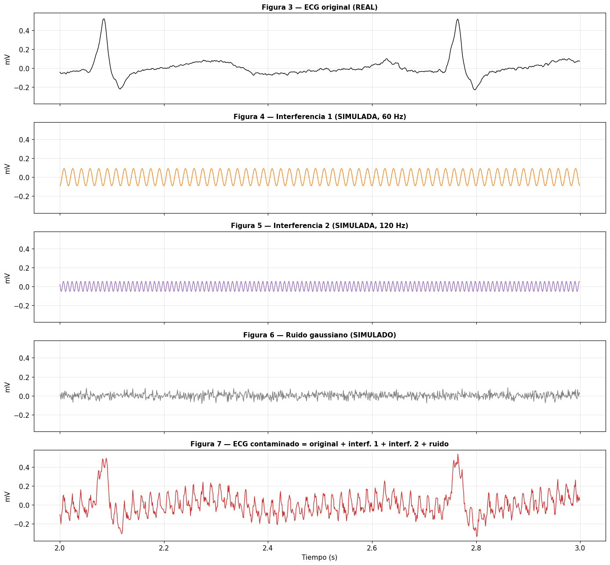
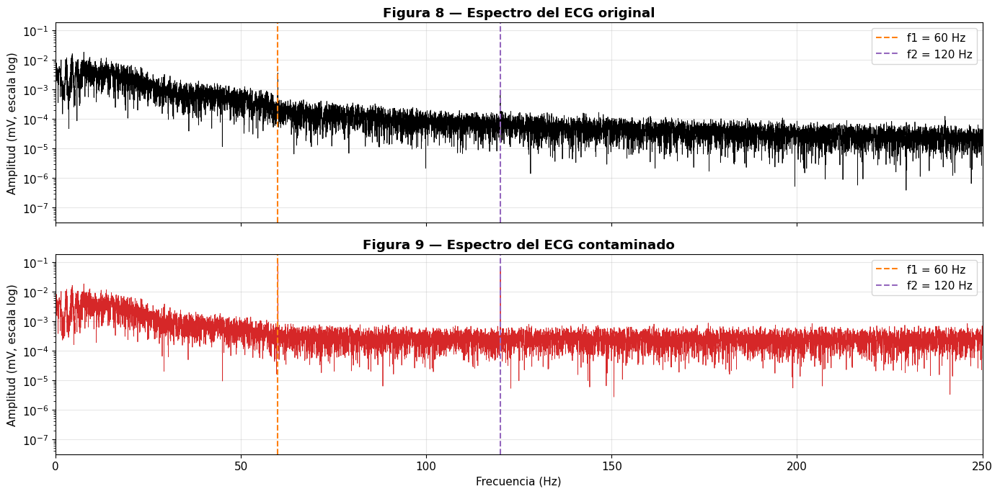
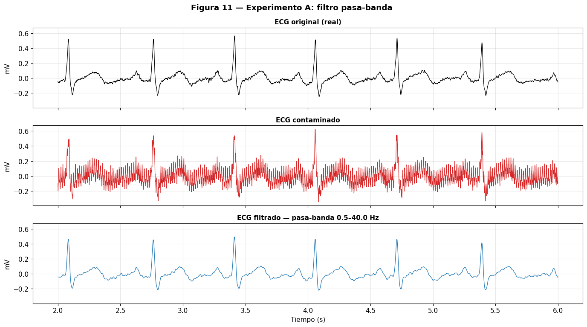
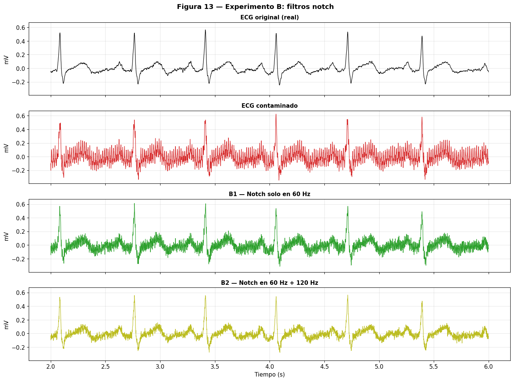
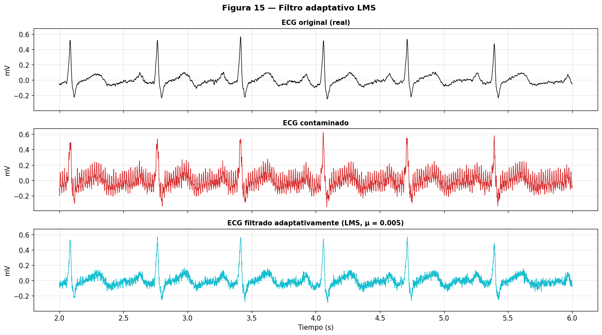
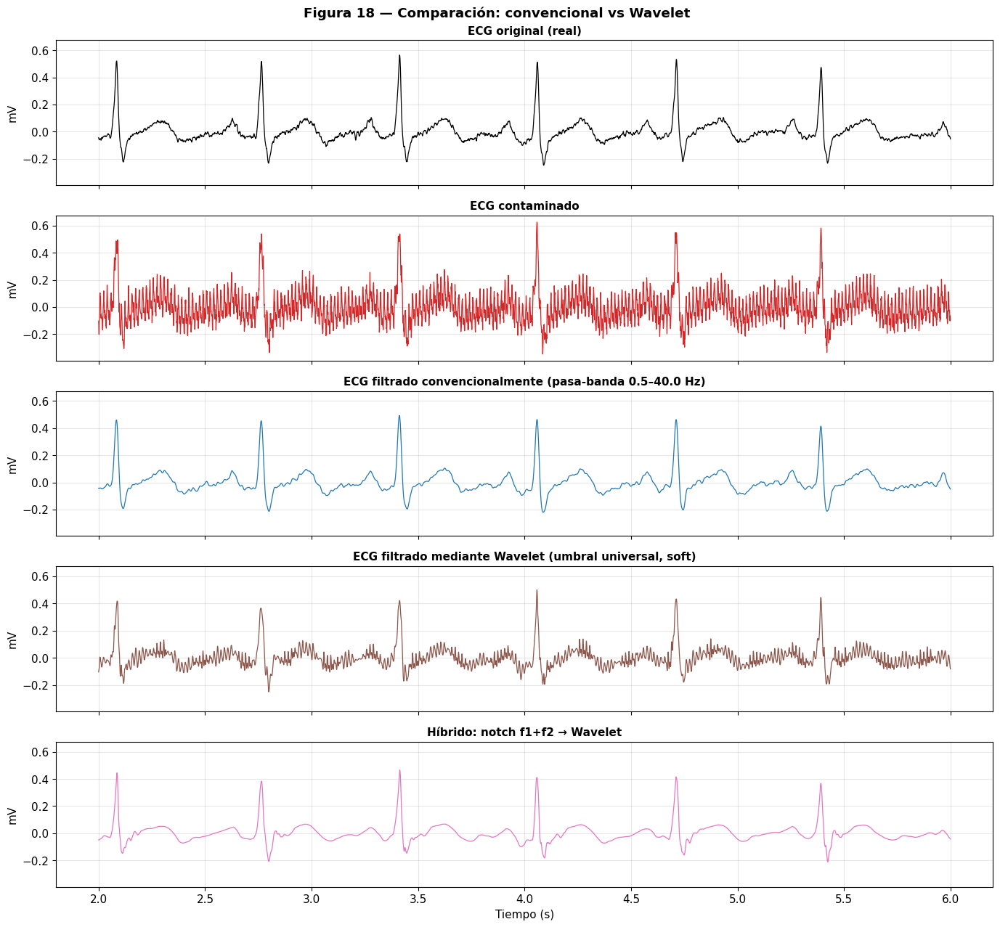
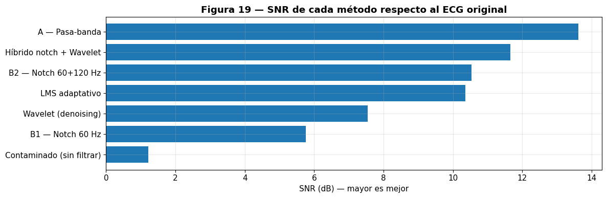
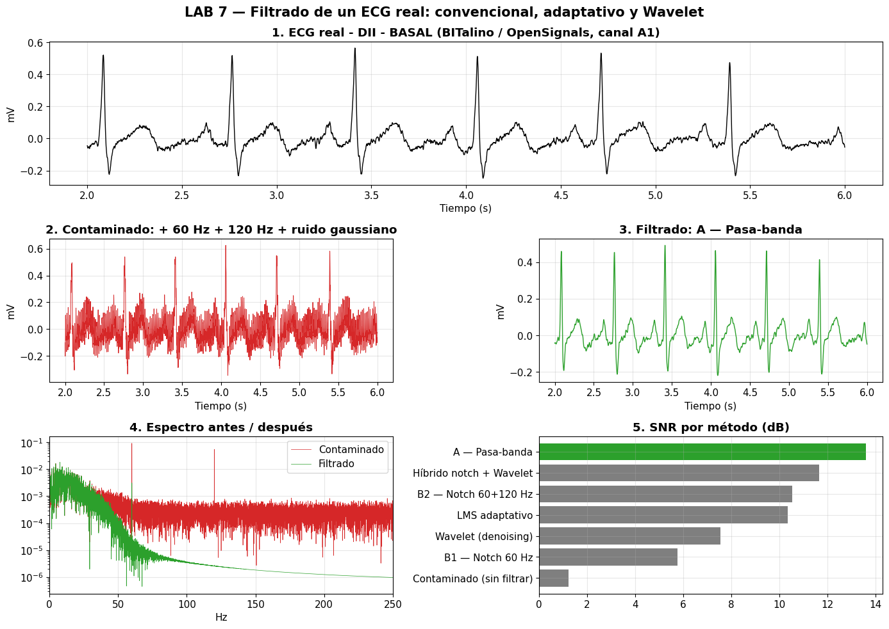

<h1 align="center">Filtrado de señales ECG: filtros convencionales, LMS y Transformada Wavelet</h1>

<em>Laboratorio 7 — Introducción a Señales Biomédicas</em>

**Grupo 4 — 2026-II**  
**Integrantes:** Astrid Sophia Mejía Barreto, Geraldine Mayte Segura Villarreal, José Fernando Vera Meza y Solangel Macedo Pereira.  
**Fecha de laboratorio:** 02/10/2026.

## Índice

- [1. Introducción](#1-introducción)
- [2. Fundamento teórico del laboratorio](#2-fundamento-teórico-del-laboratorio)
  - [2.1 Adquisición y digitalización del ECG](#21-adquisición-y-digitalización-del-ecg)
  - [2.2 Ruido, interferencias y análisis espectral](#22-ruido-interferencias-y-análisis-espectral)
  - [2.3 Filtros digitales convencionales](#23-filtros-digitales-convencionales)
  - [2.4 Filtrado adaptativo LMS](#24-filtrado-adaptativo-lms)
  - [2.5 Transformada Wavelet y denoising](#25-transformada-wavelet-y-denoising)
  - [2.6 Métricas de evaluación](#26-métricas-de-evaluación)
- [3. Procedimiento experimental](#3-procedimiento-experimental)
- [4. Resultados](#4-resultados)
- [5. Análisis y comparación](#5-análisis-y-comparación)
- [6. Respuestas al cuestionario](#6-respuestas-al-cuestionario)
- [7. Síntesis e infografía](#7-síntesis-e-infografía)
- [8. Conclusiones](#8-conclusiones)
- [9. Referencias](#9-referencias)

# 1. Introducción

Las señales electrocardiográficas (ECG) registran la actividad eléctrica del corazón, pero durante su adquisición pueden incorporar ruido electrónico, interferencia de la red eléctrica y artefactos de movimiento. Estas perturbaciones pueden ocultar las ondas P y T, modificar los complejos QRS y dificultar el análisis de la señal. Por ello, el filtrado debe reducir los componentes no deseados sin alterar innecesariamente la información fisiológica.

En este laboratorio se trabajó con un ECG real registrado mediante **BITalino (r)evolution y OpenSignals**. Primero se examinó la señal original y luego se añadieron artificialmente dos interferencias sinusoidales y ruido gaussiano. Sobre ese registro contaminado se aplicaron filtros **pasa-banda**, **notch**, un cancelador adaptativo **LMS** y métodos basados en **Wavelet**, para comparar su desempeño mediante gráficas y métricas cuantitativas.

**Objetivos:** identificar correctamente el canal ECG y sus parámetros de adquisición; reconocer ruido e interferencias en tiempo y frecuencia; implementar diferentes técnicas de filtrado; y evaluar cuánto ruido se reduce y cuánto se conserva de la morfología del ECG.

# 2. Fundamento teórico del laboratorio

## 2.1 Adquisición y digitalización del ECG

El ECG registra diferencias de potencial originadas por la despolarización y repolarización cardíaca. Su morfología comprende la **onda P**, asociada a la despolarización auricular; el **complejo QRS**, asociado a la despolarización ventricular; y la **onda T**, relacionada con la repolarización ventricular.

El archivo de OpenSignals incluye una cabecera con los metadatos y una tabla de muestras. La señal utilizada se encuentra en el canal **A1**, no en `nSeq`: esta última columna contiene un contador cíclico de paquetes que ayuda a detectar posibles pérdidas de datos. El tiempo se construye a partir de la frecuencia de muestreo:

$$
t[n]=\frac{n}{F_s},\qquad T_s=\frac{1}{F_s}
$$

Para pasar del valor del conversor analógico-digital (ADC) a milivoltios, el notebook empleó la relación de transferencia del sensor ECG:

$$
ECG_{mV}=\left(\frac{ADC}{2^{b}}-\frac{1}{2}\right)\frac{V_{CC}}{G_{ECG}}\times1000
$$

Donde $b=10$ bits, $V_{CC}=3.3$ V y $G_{ECG}=1100$. Posteriormente se restó la media para centrar la señal en cero.

| Parámetro | Valor registrado |
|---|---:|
| Derivación y canal | DII, A1 |
| Frecuencia de muestreo | 1000 Hz |
| Periodo de muestreo | 1 ms |
| Resolución | 10 bits (1024 niveles) |
| Número de muestras | 38 550 |
| Duración | 38.55 s |
| Posibles pérdidas detectadas mediante `nSeq` | 0 |

## 2.2 Ruido, interferencias y análisis espectral

El **ruido** es una perturbación no deseada, generalmente aleatoria, que puede abarcar numerosas frecuencias. Una **interferencia** suele presentar una estructura reconocible, como una oscilación periódica causada por la red eléctrica. Ambos componentes pueden dificultar la identificación de las ondas del ECG.

Para comprobar los efectos del filtrado, se sumaron a la señal original dos interferencias sinusoidales de **60 Hz** y **120 Hz** y ruido gaussiano. La contaminación fue **simulada y controlada**: no debe confundirse con todo el ruido presente durante una adquisición real.

$$
ECG_c[n]=ECG_o[n]+i_{60}[n]+i_{120}[n]+r[n]
$$

Las amplitudes de las interferencias se fijaron como proporciones de la desviación estándar del ECG original. Se utilizó una semilla aleatoria de 42 para reproducir las señales generadas.

| Componente añadida | Parámetro del notebook |
|---|---|
| Interferencia de red | 60 Hz; amplitud 0.092 mV |
| Segundo armónico | 120 Hz; amplitud 0.055 mV |
| Ruido gaussiano | Desviación estándar 0.028 mV |

La **Transformada Rápida de Fourier (FFT)** permitió visualizar estas componentes en el dominio frecuencial: las senoides generan picos alrededor de sus frecuencias, mientras que el ruido de banda ancha eleva el fondo del espectro. Este análisis ayuda a decidir qué filtro aplicar.

## 2.3 Filtros digitales convencionales

Los filtros convencionales utilizan coeficientes definidos previamente. En el laboratorio se aplicaron los siguientes:

| Método | Configuración | Propósito |
|---|---|---|
| **Pasa-banda Butterworth** | Orden 4; 0.5–40 Hz | Reducir deriva lenta y componentes de alta frecuencia |
| **Notch 60 Hz** | $Q=30$ | Atenuar la primera interferencia sinusoidal |
| **Notch 60 + 120 Hz** | Dos notch en cascada; $Q=30$ | Atenuar ambas interferencias sinusoidales |

El **pasa-banda** conserva principalmente el intervalo seleccionado, pero también puede reducir componentes verdaderas del ECG fuera de ese rango. Por ejemplo, un corte superior demasiado bajo puede suavizar el QRS y alterar su amplitud.

El **notch** rechaza una región estrecha del espectro alrededor de una frecuencia conocida. Su ancho aproximado depende del factor de calidad:

$$
BW\approx\frac{f_0}{Q}
$$

Un valor bajo de $Q$ produce una muesca más ancha y puede afectar más componentes próximas; un valor alto produce una muesca más estrecha, que requiere mayor precisión en la frecuencia a eliminar. Los filtros se aplicaron con `sosfiltfilt` y `filtfilt`, que procesan la señal hacia adelante y hacia atrás para evitar el desfase, aunque pueden introducir cambios de amplitud y efectos de borde.

## 2.4 Filtrado adaptativo LMS

Un filtro adaptativo modifica sus coeficientes durante el procesamiento para ajustarse a una interferencia. El laboratorio implementó un cancelador basado en el algoritmo **LMS (*Least Mean Squares*)**, que recibe el ECG contaminado y referencias correlacionadas con el ruido que desea estimar.

En este caso, las referencias fueron senos y cosenos de **60 Hz y 120 Hz**, lo que permitió ajustar la amplitud y fase de ambas interferencias. El filtro estima la componente no deseada $y[n]$ y la resta de la entrada $d[n]$:

$$
e[n]=d[n]-y[n]
$$

Los coeficientes se actualizan mediante:

$$
w[n+1]=w[n]+2\mu\,e[n]x[n]
$$

Donde $x[n]$ es el vector de referencias y $\mu$ controla el paso de adaptación. En el notebook se utilizó **$\mu=0.005$**. Un paso demasiado pequeño retrasa la convergencia y uno elevado puede provocar oscilaciones y degradar la señal. Como el ruido gaussiano no está correlacionado con estas referencias, el LMS implementado no está diseñado para eliminarlo.

## 2.5 Transformada Wavelet y *denoising*

La **Transformada Wavelet Discreta (DWT)** permite estudiar componentes de la señal según su escala y localización temporal. Es útil en el ECG porque los complejos QRS son eventos breves, mientras que la línea de base y otras ondas varían más lentamente. A diferencia de una FFT global, la DWT permite identificar componentes transitorias y analizar su ubicación temporal.

En el laboratorio se utilizó la wavelet **Daubechies 4 (`db4`)** con **8 niveles de descomposición**. En cada nivel se obtienen coeficientes de **aproximación (A)**, asociados a componentes de menor frecuencia, y de **detalle (D)**, asociados a componentes de mayor frecuencia. De forma aproximada, las interferencias de 120 Hz y 60 Hz se sitúan en las bandas D3 y D4, respectivamente.

Para reducir el ruido mediante *Wavelet denoising*, se descompuso la señal y se estimó la desviación estándar del ruido a partir de los coeficientes de detalle D1. Posteriormente, se calculó el umbral universal mediante las siguientes expresiones:

$$
\sigma \approx \frac{\mathrm{median}(|D_1|)}{0.6745}
$$

$$
\lambda = \sigma \sqrt{2\ln(N)}
$$

Donde:

- $\sigma$: desviación estándar estimada del ruido.
- $D_1$: coeficientes de detalle del primer nivel.
- $N$: número de muestras de la señal.
- $\lambda$: umbral utilizado para la reducción de ruido.

Se aplicó **umbralización suave (*soft thresholding*)**, que anula los coeficientes cuya magnitud es inferior al umbral y reduce la magnitud de los restantes. El umbral calculado en el laboratorio fue **0.1289**.

Este procedimiento permite atenuar componentes de ruido de banda ancha, pero no garantiza eliminar interferencias sinusoidales intensas, cuyos coeficientes pueden superar el umbral establecido. Por ello, también se evaluó una estrategia **híbrida**, combinando filtros notch de 60 Hz y 120 Hz con un procesamiento posterior mediante Wavelet.

## 2.6 Métricas de evaluación

La calidad del filtrado se evaluó comparando cada señal procesada con el ECG real original, empleado como referencia de este ejercicio. Se excluyeron los **primeros y últimos 2 segundos** para reducir los efectos de borde y el impacto inicial de la adaptación.

| Métrica | Significado | Mejor desempeño |
|---|---|---|
| **RMSE (mV)** | Raíz del error cuadrático medio respecto al ECG de referencia | Menor valor |
| **SNR (dB)** | Relación entre la energía de referencia y la del error | Mayor valor |
| **Correlación de Pearson ($r$)** | Similitud entre las formas de ambas señales | Más cercana a 1 |

$$
RMSE=\sqrt{\frac{1}{N}\sum_{n=1}^{N}(x[n]-\hat x[n])^2}
$$

$$
SNR=10\log_{10}\left(\frac{\sum_n x[n]^2}{\sum_n(x[n]-\hat x[n])^2}\right)
$$

Estas métricas deben interpretarse junto con las gráficas, ya que una señal con menos error global todavía puede presentar cambios importantes en las ondas P, QRS o T.

# 3. Procedimiento experimental

1. **Exploración de datos:** se leyó `DII_BASAL.txt`, se verificaron los metadatos y la continuidad del contador `nSeq`, y se extrajo el ECG de `A1`.
2. **Señal original:** se convirtió la lectura ADC a milivoltios, se centró respecto a cero y se visualizaron el registro completo y una ventana de 4 segundos.
3. **Contaminación:** se sumaron al ECG las senoides de 60 y 120 Hz y ruido gaussiano; posteriormente se compararon sus representaciones temporales y espectrales mediante FFT.
4. **Experimento A:** se aplicó el filtro pasa-banda Butterworth de 0.5–40 Hz.
5. **Experimento B:** se probó un notch de 60 Hz y después dos notch en cascada de 60 y 120 Hz.
6. **Filtrado LMS:** se implementó la adaptación con referencias sinusoidales y paso $\mu=0.005$, observando también la convergencia de los coeficientes.
7. **Wavelet e híbrido:** se descompuso la señal usando `db4`, se aplicó umbralización suave y se comparó con notch seguido de Wavelet.
8. **Evaluación:** se calcularon RMSE, SNR y correlación; finalmente se elaboró una figura base para la infografía.

# 4. Resultados

## 4.1 ECG original y contaminación

La contaminación añadida modificó visiblemente el registro ECG y dificultó la identificación de las ondas de menor amplitud. Los complejos QRS continuaron siendo reconocibles debido a su mayor amplitud.

 <em>Fig 1. Señal ECG original, interferencias simuladas y señal ECG contaminada.</em>

En el dominio de la frecuencia se observó un aumento del contenido espectral de la señal contaminada, destacando los picos correspondientes a las interferencias añadidas de 60 Hz y 120 Hz.

 <em>Fig 2. Espectro del ECG original y del ECG contaminado.</em>

## 4.2 Filtros convencionales

El filtro pasa-banda redujo las componentes de alta frecuencia, obteniéndo una señal visualmente más cercana al ECG original, aunque con una ligera modificación de su amplitud.

 <em>Fig 3. Comparación del ECG original, ECG contaminado y señal filtrada mediante pasa-banda.</em>

Los filtros Notch mostraron una eliminación más selectiva de las interferencias. La aplicación conjunta de los Notch de 60 y 120 Hz produjo una mejor recuperación que el uso únicamente del Notch de 60 Hz.

 <em>Fig 4. Comparación de los resultados obtenidos con los filtros Notch de 60 Hz y 60 + 120 Hz.</em>

## 4.3 LMS y Wavelet

El filtro adaptativo LMS redujo las componentes sinusoidales utilizadas como referencia, manteniendo la forma general del ECG. Sin embargo, permaneció parte del ruido gaussiano presente en la señal.

 <em>Fig 5. Comparación del ECG original, ECG contaminado y señal filtrada mediante LMS.</em>

El procesamiento Wavelet redujo parte del ruido de banda ancha. Al combinar los filtros Notch con Wavelet se obtuvo una señal con menor interferencia y una buena conservación de la morfología respecto al ECG original.

 <em>Fig 6. Comparación de los resultados obtenidos mediante Wavelet y el método híbrido Notch + Wavelet.</em>

## 4.4 Comparación cuantitativa

La comparación mediante RMSE, SNR y correlación permitió complementar la evaluación visual de los métodos.

| Método | RMSE (mV) ↓ | SNR (dB) ↑ | Correlación $r$ ↑ |
|---|---:|---:|---:|
| Contaminado (sin filtrar) | 0.0803 | 1.2186 | 0.7556 |
| Pasa-banda | 0.0193 | 13.6134 | 0.9780 |
| Notch 60 Hz | 0.0476 | 5.7609 | 0.8888 |
| Notch 60 + 120 Hz | 0.0275 | 10.5407 | 0.9586 |
| LMS adaptativo | 0.0281 | 10.3573 | 0.9577 |
| Wavelet | 0.0388 | 7.5400 | 0.9077 |
| Híbrido Notch + Wavelet | 0.0242 | 11.6570 | 0.9756 |

El pasa-banda presentó el mayor SNR y el menor RMSE del experimento. El método híbrido Notch + Wavelet obtuvo el segundo mayor SNR y una correlación cercana a la obtenida con el pasa-banda, mientras que el Notch de 60 Hz aislado presentó la menor mejora entre los métodos de filtrado evaluados.

 <em>Fig 7. Comparación del SNR obtenido con los diferentes métodos de filtrado.</em>

La Figura 8 resume el efecto de la contaminación, la recuperación de la señal y el desempeño relativo de los métodos evaluados.

 <em>Fig 8. Resumen de los principales resultados del procesamiento del ECG: señal original, señal contaminada, filtrado pasa-banda, comparación espectral y SNR de los métodos evaluados.</em>

# 5. Análisis y comparación

Los resultados muestran que el desempeño de cada método depende principalmente del tipo de contaminación que se desea eliminar. Aunque el filtro pasa-banda obtuvo los mejores valores cuantitativos del experimento, su acción no es completamente selectiva: además del ruido, también elimina contenido del ECG que se encuentra fuera de la banda establecida. Por ello, una mayor SNR no necesariamente implica que la señal sea la más adecuada para cualquier aplicación biomédica.

Los filtros Notch fueron más específicos, ya que actuaron principalmente sobre las frecuencias conocidas de 60 y 120 Hz. Esto permitió eliminar las interferencias sinusoidales con poca modificación del resto del espectro; sin embargo, su capacidad para reducir el ruido gaussiano fue limitada. Además, requieren conocer previamente las frecuencias que se desean eliminar.

El filtro LMS presentó un comportamiento similar al doble Notch, pero con la ventaja de modificar sus coeficientes durante el procesamiento. En este caso pudo estimar las interferencias de 60 y 120 Hz gracias a las referencias utilizadas. Su principal limitación fue que el ruido gaussiano permaneció en la señal debido a que no estaba correlacionado con dichas referencias.

Por otro lado, el procesamiento mediante Wavelet permitió actuar sobre componentes distribuidas en diferentes escalas y reducir ruido de banda ancha mediante umbralización. Sin embargo, aplicado de manera independiente no eliminó completamente las interferencias sinusoidales. Al combinar Notch + Wavelet, primero se eliminaron las componentes de frecuencia conocida y posteriormente se redujo parte del ruido restante, obteniéndose un buen equilibrio entre reducción de ruido y conservación de la forma del ECG.

| Criterio | Pasa-banda | Notch | LMS adaptativo | Wavelet | Híbrido |
|---|---|---|---|---|---|
| Reducción de interferencias 60/120 Hz | Alta | Alta | Alta | Media | Alta |
| Reducción de ruido gaussiano | Media | Baja | Baja | Alta | Alta |
| Conservación de la morfología | Alta | Alta | Alta | Media | Alta |
| Distorsión introducida | Baja–media | Baja | Baja–media | Media | Baja–media |
| Complejidad | Baja | Baja | Media | Media | Media–alta |
| Requisito principal | Conocer banda de interés | Conocer frecuencia | Señal de referencia | Elegir wavelet y umbral | Configurar ambos métodos |

En conjunto, ningún método puede considerarse universalmente superior. Para este experimento, el pasa-banda fue el más eficiente según las métricas calculadas, mientras que el método híbrido resultó conveniente cuando se buscó tratar simultáneamente interferencias de frecuencia conocida y ruido de banda ancha. En una aplicación biomédica, la selección del filtro debe realizarse considerando no solo la reducción del ruido, sino también la posible distorsión y la conservación de la información fisiológica de interés.

# 6. Respuestas al cuestionario

**1. ¿Por qué es importante conocer la frecuencia de muestreo de una señal biomédica?**  
Porque permite construir correctamente el eje temporal y conocer el intervalo entre muestras. También determina el rango de frecuencias que puede representarse sin aliasing; por el criterio de Nyquist, la frecuencia de muestreo debe superar el doble de la frecuencia máxima de interés.

**2. ¿Qué diferencia existe entre ruido e interferencia?**  
El ruido suele ser aleatorio y distribuirse en distintas frecuencias, mientras que una interferencia puede tener una estructura definida, como una senoide de 60 Hz. Esta diferencia permite elegir métodos específicos para cada perturbación.

**3. ¿Por qué una interferencia sinusoidal puede observarse como un pico en el dominio de la frecuencia?**  
Porque una senoide concentra su contenido espectral alrededor de una frecuencia determinada. En cambio, el ruido gaussiano de banda ancha se distribuye entre numerosas frecuencias y eleva el fondo del espectro.

**4. ¿Qué sucede cuando aplicamos un filtro demasiado agresivo a una señal ECG?**  
Además de reducir el ruido, puede eliminar componentes fisiológicas. Si se reduce demasiado la frecuencia de corte superior, el QRS puede aparecer suavizado, con menor amplitud y detalles perdidos, afectando su interpretación.

**5. ¿Cuál es la principal diferencia conceptual entre un filtro convencional y un filtro adaptativo?**  
Un filtro convencional utiliza coeficientes establecidos al diseñarlo. El adaptativo modifica sus coeficientes durante el procesamiento según una señal de error, por lo que puede seguir ciertas variaciones de la interferencia si cuenta con una referencia adecuada.

**6. ¿Para qué sirve la Transformada Wavelet?**  
Permite descomponer una señal en componentes de diferentes escalas y estudiar cómo se distribuyen en el tiempo. También puede utilizarse para reducir ruido mediante umbralización y posterior reconstrucción.

**7. ¿Por qué la Transformada Wavelet puede resultar útil para analizar señales biomédicas?**  
Porque las señales biomédicas contienen eventos transitorios, como el complejo QRS, que no se describen completamente con un espectro global. Wavelet permite localizar esos eventos y analizar simultáneamente variaciones rápidas y lentas.

**8. ¿Qué información podría perderse durante el proceso de filtrado?**  
Pueden perderse amplitudes, detalles de las ondas P y T, componentes rápidas del QRS o variaciones lentas de la línea de base. Un filtro excesivo puede generar una señal aparentemente limpia, pero menos fiel al registro original.

**9. Si conoces la frecuencia exacta de una interferencia, ¿qué tipo de filtro podrías utilizar?**  
Se puede utilizar un filtro notch centrado en esa frecuencia. Por ejemplo, para atenuar componentes de 60 y 120 Hz se pueden aplicar dos notch en cascada, cuidando que su ancho de rechazo no afecte innecesariamente al ECG.

**10. ¿Por qué no debemos evaluar un filtro únicamente observando visualmente la señal?**  
Porque una señal más suave no garantiza menor error ni conservación de la morfología. Conviene combinar la inspección del ECG y su espectro con métricas como RMSE, SNR y correlación, considerando las limitaciones de cada medida.

# 7. Síntesis e infografía

En este laboratorio se analizó una señal ECG real adquirida mediante BITalino/OpenSignals, a la cual se añadieron interferencias de 60 Hz y 120 Hz, además de ruido gaussiano, para evaluar diferentes técnicas de filtrado. Se compararon un filtro pasa-banda Butterworth, filtros Notch, un filtro adaptativo LMS, Wavelet db4 y un método híbrido Notch + Wavelet.

El filtro pasa-banda obtuvo el mejor desempeño cuantitativo, con un SNR de 13.61 dB, RMSE de 0.0193 mV y correlación de 0.9780, aunque modificó ligeramente la señal original. El método híbrido Notch + Wavelet alcanzó un SNR de 11.66 dB y mostró un buen equilibrio entre reducción de interferencias y conservación de la morfología del ECG.

El LMS fue útil para cancelar componentes correlacionadas con referencias de 60 y 120 Hz, mientras que Wavelet permitió reducir ruido manteniendo información temporal importante. En conjunto, los resultados muestran que la elección del método depende del tipo de ruido y del compromiso entre reducción de interferencia, distorsión y preservación de la información fisiológica.

# 8. Conclusiones

En este laboratorio, los métodos de filtrado permitieron reducir de forma importante el ruido y las interferencias añadidas al ECG, mejorando la relación señal-ruido respecto a la señal contaminada. El filtro pasa-banda obtuvo el mejor desempeño cuantitativo, con un SNR de 13.61 dB, aunque también modificó parcialmente la señal original. El doble notch y el filtro LMS conservaron mejor la morfología del ECG, pero fueron menos eficaces frente al ruido gaussiano. El método Wavelet permitió reducir ruido de banda ancha preservando información temporal, aunque su desempeño dependió de la wavelet y del umbral seleccionados. La estrategia híbrida notch + Wavelet mostró un buen equilibrio entre reducción de interferencias y conservación de la forma del ECG. En cuanto a complejidad, los filtros convencionales son más simples de implementar, mientras que LMS y Wavelet requieren mayor ajuste de parámetros. En aplicaciones biomédicas, la elección del método debe considerar tanto la reducción del ruido como la preservación de la información fisiológica relevante.

# 9. Referencias

- Universidad Peruana Cayetano Heredia. *Laboratorio 7 — Filtrado de señales II: Filtros adaptativos y Transformada Wavelet aplicados a ECG*. Cuaderno práctico del curso Introducción a Señales Biomédicas, 2026.
- PLUX Wireless Biosignals. *Documentación técnica del sensor ECG de BITalino y del software OpenSignals* (citada para la interpretación de los datos de adquisición y la conversión ADC).
- SciPy. *Signal processing (`scipy.signal`)*. https://docs.scipy.org/doc/scipy/reference/signal.html
- PyWavelets. *PyWavelets documentation*. https://pywavelets.readthedocs.io/

