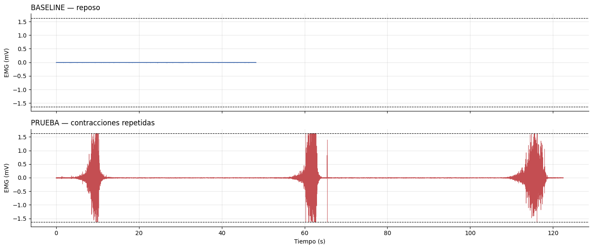
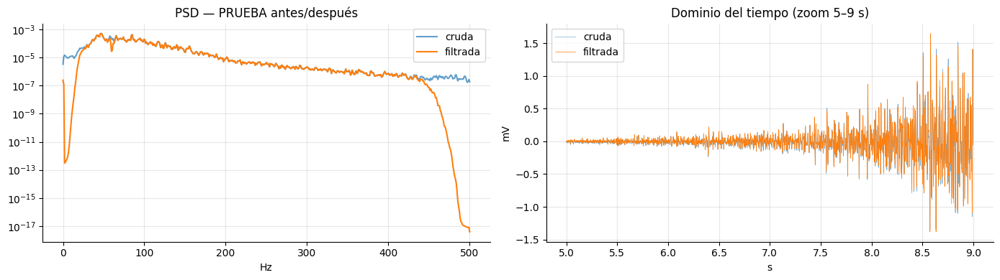
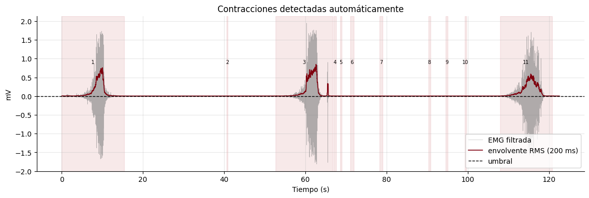
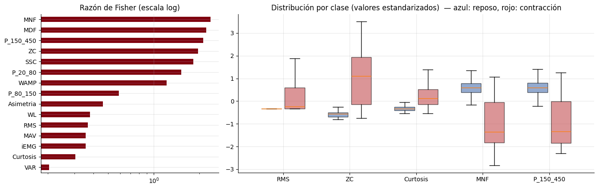
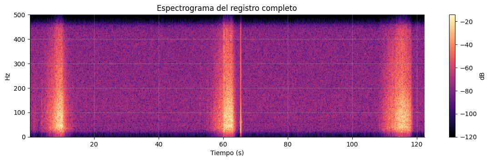
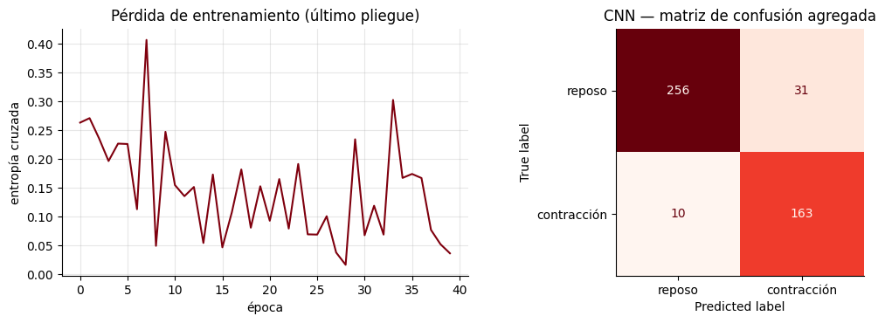
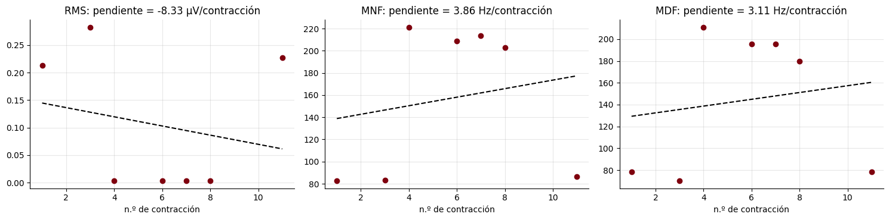

<h1 align="center">Extracción de características y clasificación de la señal sEMG</h1>

<em>Laboratorio 10 — Introducción a Señales Biomédicas</em>

**Grupo 4 — 2026-II**  
**Integrantes:** Astrid Sophia Mejía Barreto, Geraldine Mayte Segura Villarreal, José Fernando Vera Meza y Solangel Macedo Pereira.  
**Fecha de laboratorio:** 23/10/2026.

## Índice

- [1. Introducción](#1-introducción)
- [2. Fundamento teórico del laboratorio](#2-fundamento-teorico-del-laboratorio)
  - [2.1 Señal sEMG](#21-señal-semg)
  - [2.2 Adquisición y conversión](#22-adquisición-y-conversión)
  - [2.3 Ruido, saturación y calidad de la señal](#23-ruido-saturación-y-calidad-de-la-señal)
  - [2.4 Filtrado](#24-filtrado)
  - [2.5 Detección de las contracciones](#25-detección-de-las-contracciones)
  - [2.6 Ventanas y etiquetado](#26-ventanas-y-etiquetado)
  - [2.7 Características](#27-características)
  - [2.8 Interpretación](#28-interpretación)
- [3. Procedimiento](#3-procedimiento)
- [4. Resultados](#4-resultados)
  - [4.1 Adquisición y saturación](#41-adquisición-y-saturación)
  - [4.2 Filtrado](#42-filtrado)
  - [4.3 Detección de contracciones](#43-detección-de-contracciones)
  - [4.4 Características](#44-características)
  - [4.5 Clasificación con LDA, SVM y CNN](#45-clasificación-con-lda-svm-y-cnn)
  - [4.6 Análisis de fatiga](#46-análisis-de-fatiga)
- [5. Conclusiones](#5-conclusiones)
- [6. Referencias](#6-referencias)

# 1. Introducción
La electromiografía de superficie (sEMG) registra la actividad eléctrica de un músculo mediante electrodos colocados sobre la piel. La señal es muy pequeña (de microvoltios a pocos milivoltios) y se contamina fácilmente con ruido electrónico, interferencia de la red eléctrica, movimiento de los electrodos, saturación del conversor, entre otros. Es por ello, antes de analizarla hay que filtrarla y luego resumirla en números llamados características.

En este laboratorio se trabajó con dos registros de un músculo del antebrazo, adquiridos con BITalino (r)evolution y OpenSignals: uno en reposo (BASELINE), usado como referencia del ruido, y otro con contracciones repetidas separadas por reposo (PRUEBA). Primero se convirtió la señal a milivoltios y se revisó su calidad. Después se filtró, se detectaron automáticamente las contracciones, se dividió la señal en ventanas y se calcularon características de cada ventana para compararlas entre reposo y contracción.

Objetivos:

- Explicar de dónde viene la señal sEMG y cuáles son sus rangos típicos.
- Convertir, filtrar y evaluar la calidad de una señal real de BITalino.
- Detectar los periodos de contracción con la envolvente y un umbral.
- Calcular e interpretar características de la señal por ventanas.

# 2. Fundamento teórico del laboratorio

### 2.1 Señal sEMG
El músculo se organiza en unidades motoras (motoneurona y las fibras musculares que controla). Cada vez que la motoneurona dispara, sus fibras generan un pequeño potencial eléctrico. Sin embargo, el electrodo de superficie no ve cada unidad por separado, sino la suma de los potenciales de todas las unidades activas. Es por ello que la señal parece ruido aleatorio.

Asimismo, el cuerpo aumenta la fuerza de dos formas: reclutando más unidades motoras o haciendo que cada una dispare más rápido. Estos casos aumentan la amplitud de la señal.

| Propiedad | Valor típico |
|---|---|
| Amplitud | De microvoltios (reposo) a pocos milivoltios |
| Banda útil | Aprox. 20–450 Hz (según la fuente, 10–500 Hz) |
| Frecuencias donde hay más energía | Aprox. 50–150 Hz |

Hay que tener en cuenta que la piel y la grasa actúan como un filtro pasabajas, por eso en superficie la señal tiene menos frecuencias altas que dentro del músculo.

### 2.2 Adquisición y conversión 
El BITalino mide la diferencia de voltaje entre dos electrodos sobre el músculo, usando un tercero como referencia. Se restan ambas señales para reducir el ruido que les llega como la interferencia de la red. La señal se amplifica, filtra y digitaliza con un conversor analógico-digital (ADC) de 10 bits, que entrega valores enteros de 0 a 1023.

La frecuencia de muestreo fue $F_s = 1000$ Hz, así que la frecuencia máxima que se puede representar es 500 Hz (Nyquist), es suficiente para la banda de la sEMG. El tiempo de cada muestra es:

$$t[n] = \frac{n}{f_s}$$

Para pasar del valor del ADC a milivoltios se usa la ecuación de la hoja técnica del sensor:

$$EMG_{mV} = \frac{\left(\dfrac{ADC}{2^{n}} - \dfrac{1}{2}\right) V_{CC}}{G_{EMG}} \times 1000$$

con $n=10$ bits, $V_{CC}=3.3$ V y $G_{EMG}=1009$. Esto da un rango medible de aproximadamente **±1.63 mV**; si la señal es mayor, el ADC se satura.

| Parámetro | Valor |
|---|---|
| Sensor / canal | EMGBITREV / A1 |
| Músculo | Antebrazo |
| Frecuencia de muestreo | 1000 Hz |
| Resolución | 10 bits |
| BASELINE (reposo) | 48 300 muestras (48.3 s) |
| PRUEBA (contracciones) | 122 550 muestras (122.5 s) |

### 2.3 Ruido, saturación y calidad de la señal
| Fuente | Qué es | Cómo se reduce |
|---|---|---|
| Interferencia de la red | Oscilación a 60 Hz (y 120 Hz, etc.) | Filtro notch |
| Artefactos de movimiento | Frecuencias bajas (menos de 20 Hz) | Filtro pasa-altos |
| Ruido electrónico | Ruido aleatorio en todas las frecuencias | Se mide con el registro en reposo |
| Saturación | La señal se nivela en el máximo o mínimo del ADC | Se evita al grabar; los filtros no la corrigen |

**Espectro** Se usa para ver en qué frecuencias está la potencia de la señal, se calcula la densidad espectral de potencia (PSD). El método de Welch divide la señal en segmentos, calculando el espectro de cada uno y los promedia, da estimación más estable que una sola FFT. Se visualizan las interferencias de red como picos angostos.

**Saturación.** Una muestra está saturada si su valor del ADC es 0 o 1023. El recorte elimina los picos más altos y distorsiona sobre todo la curtosis, que tiende a disminuir.

**Relación señal-ruido (SNR).** Se estima usando el reposo como referencia del ruido:

$$SNR \approx 20\log_{10}\!\left(\frac{RMS_{prueba}}{RMS_{baseline}}\right)\ \text{dB}$$

### 2.4 Filtrado
Primero se resta la media para centrar la señal en cero, luego se aplican dos filtros:

| Filtro | Configuración | Para qué sirve |
|---|---|---|
| Pasa-banda Butterworth | Orden 4, 20–450 Hz | Quitar derivas, movimiento y ruido de alta frecuencia |
| Notch | 60 Hz, $Q=30$ | Quitar la interferencia de la red |

El ancho del notch depende de $Q$:

$$BW \approx \frac{f_0}{Q}$$

Con $Q=30$ la muesca es angosta (unos 2 Hz), así que casi no afecta las frecuencias vecinas. Los filtros se aplicaron hacia adelante y hacia atrás (`filtfilt`) para que la señal no se desfase; esto sirve para análisis posterior, no para tiempo real.

### 2.5 Detección de las contracciones

Como la sEMG oscila alrededor de cero, se calcula su **envolvente RMS**, una curva suave que sigue la amplitud de la señal. Con una ventana móvil de $W$ muestras (200 ms):

$$RMS[n] = \sqrt{\frac{1}{W}\sum_{k=n-W/2}^{n+W/2} x[k]^{2}}$$

Se considera que hay contracción cuando la envolvente supera un umbral calculado con el reposo:

$$\text{umbral} = \mu_{reposo} + k\,\sigma_{reposo}, \qquad k = 5$$

### 2.6 Ventanas y etiquetado

La sEMG cambia con el tiempo, así que las características se calculan en ventanas cortas. Se usaron ventanas de 250 ms con 50 % de solapamiento. Cada ventana se etiqueta según qué fracción de ella cae dentro de una contracción:

| Etiqueta | Criterio |
|---|---|
| Contracción | 80 % o más dentro de una contracción |
| Reposo | 5 % o menos |
| Transición | El resto |

La amplitud se reporta en mV, sin normalizar

### 2.7 Características

Una característica es un número que resume una ventana de $N$ muestras $x_i$. En el laboratorio se calcularon 15, en cuatro grupos.

**Amplitud**

| Característica | Fórmula |
|---|---|
| MAV (valor absoluto medio) | $\displaystyle \frac{1}{N}\sum \lvert x_i\rvert$ |
| RMS | $\displaystyle \sqrt{\frac{1}{N}\sum x_i^{2}}$ |
| iEMG | $\displaystyle \sum \lvert x_i\rvert$ |
| VAR (varianza) | $\displaystyle \frac{1}{N-1}\sum (x_i-\bar{x})^{2}$ |

El RMS aumenta con la fuerza, depende del músculo y de la persona. Con ventanas del mismo tamaño, iEMG es MAV multiplicado por $N$, así que dan la misma información.

**Complejidad** ZC, SSC y WAMP solo cuentan los cambios mayores a un umbral de ruido $\varepsilon$, se tomó como $3\sigma$ del reposo.

| Característica | Qué mide |
|---|---|
| WL (longitud de forma de onda) | $\displaystyle \sum \lvert x_{i+1}-x_i\rvert$: cuánto recorre la señal |
| ZC (cruces por cero) | Veces que la señal cambia de signo (con cambio mayor a $\varepsilon$) |
| SSC (cambios de pendiente) | Veces que la señal cambia de subir a bajar (mayor a $\varepsilon$) |
| WAMP | Veces que la diferencia entre muestras seguidas supera $\varepsilon$ |

**Estadísticas** La asimetría indica si la distribución es simétrica (0). La curtosis vale 0 para una distribución gaussiana, mayor si hay picos aislados. Con muchas unidades motoras activas la sEMG se parece a una gaussiana.

**Espectrales** Se calculan a partir de la PSD de Welch entre 20 y 450 Hz:

| Característica | Qué es |
|---|---|
| MNF (frecuencia media) | $\displaystyle \frac{\sum f_j P_j}{\sum P_j}$: el centro del espectro |
| MDF (frecuencia mediana) | Frecuencia que divide la potencia en dos mitades iguales |
| Potencia por bandas | Fracción de potencia en 20–80, 80–150 y 150–450 Hz |

### 2.8 Interpretación

| Lo que se quiere saber | Qué se mira |
|---|---|
| Esfuerzo muscular | Amplitud (RMS) |
| Cuándo se activa el músculo | Amplitud sobre un umbral |
| Fatiga | RMS que aumenta y MDF/MNF que disminuyen con el tiempo |

Con la fatiga, el espectro se desplaza a frecuencias más bajas. Para detectarla bien se necesitan contracciones sostenidas y de intensidad controlada, poeque con contracciones cortas y pausas, o con saturación, puede no notarse.

# 3. Procedimiento

1. **Adquisición de datos:** se registraron señales sEMG durante periodos de reposo y contracción muscular, y se verificó la presencia de muestras saturadas en el ADC.

2. **Señal original:** se convirtieron los valores del ADC a milivoltios y se visualizaron las señales para analizar sus amplitudes y características temporales.

3. **Filtrado:** se redujo la interferencia de 60 Hz y se compararon las señales originales y filtradas mediante su representación temporal y densidad espectral de potencia (PSD). Además, se calcularon el RMS y la SNR.

4. **Detección de contracciones:** se calculó la envolvente RMS y se aplicó un umbral para identificar los periodos de actividad muscular. Posteriormente, se segmentó la señal en ventanas de reposo, contracción y transición.

5. **Extracción de características:** se calcularon parámetros temporales y frecuenciales, como RMS, ZC, WAMP, MNF, MDF y potencia espectral, para caracterizar las señales de reposo y contracción.

6. **Selección de características:** se utilizó la razón de Fisher para evaluar la capacidad discriminante de las características y se analizó su correlación para identificar posibles redundancias.

7. **Clasificación:** se implementaron los modelos LDA, SVM y CNN, utilizando características extraídas y espectrogramas. Se compararon sus desempeños mediante la exactitud balanceada y métodos de validación KFold y GroupKFold.

8. **Análisis de fatiga:** se evaluó la evolución del RMS, MNF y MDF durante las contracciones para identificar posibles cambios asociados a la fatiga muscular.

# 4. Resultados

## 4.1 Adquisición y saturación

| Parámetro | Reposo | Contracciones |
|---|---:|---:|
| Duración | 48.3 s | 122.55 s |
| Rango ADC | 504 a 514 | 0 a 1022 |
| Muestras saturadas | 0 | 32 (0.026 %) |

El rango medible del sensor fue de ±1.632 mV. El valor 1022 se repitió 113 veces, lo que indica que el techo real del conversor está ahí; contándolo, la saturación sube a **145 muestras (0.118 %)**. Todas las ventanas saturadas fueron de contracción.

 <em>Fig 1. Registros de reposo y de contracciones en mV. Las líneas punteadas marcan el rango del sensor.</em>

## 4.2 Filtrado

El filtrado eliminó la interferencia de red sin alterar la banda útil. La potencia en 60 Hz respecto a sus frecuencias vecinas pasó de 6.4 a 0.11 veces en el reposo.

| Medida | Valor |
|---|---:|
| RMS del reposo filtrado (piso de ruido) | 3.60 µV |
| RMS de la prueba filtrada | 141.02 µV |
| SNR aproximada | 31.9 dB |
| Frecuencia mediana en contracción | 75 Hz |
| Potencia de la contracción en 20–150 Hz | 92.6 % |

 <em>Fig 2. PSD antes y después del filtrado (izquierda) y zoom temporal entre 5 y 9 s (derecha).</em>

## 4.3 Detección de contracciones

Con el umbral intra-registro (3.8 µV) se detectaron **11 contracciones** de 4.21 ± 6.03 s. Tres de ellas fueron largas y claras; las demás fueron segmentos cortos con amplitud de ruido, porque el umbral quedó muy cerca del piso de ruido (3.60 µV). Se obtuvieron **979 ventanas**: 588 de reposo, 356 de contracción y 35 de transición.

 <em>Fig 3. Señal filtrada, envolvente RMS, umbral y contracciones detectadas.</em>

## 4.4 Características

| Característica | Reposo | Contracción |
|---|---:|---:|
| RMS (mV) | 0.0035 | 0.1238 |
| ZC | 3.80 | 28.86 |
| WAMP | 3.87 | 109.35 |
| MNF (Hz) | 214.9 | 134.5 |
| MDF (Hz) | 201.3 | 117.1 |
| Potencia 150–450 Hz | 0.641 | 0.303 |

Según la razón de Fisher, las más discriminantes fueron **MNF (2.37), MDF (2.21) y P 150–450 (2.12)**, mientras que las de amplitud quedaron abajo (RMS 0.37). Esto se debe a que las falsas contracciones aumentaron la dispersión del RMS en esa clase. Las características de amplitud fueron redundantes entre sí (correlación de 0.950 a 1.000).

 <em>Fig 4. Razón de Fisher y distribución de cinco características por clase.</em>

## 4.5 Clasificación con LDA, SVM y CNN

| Modelo | Exactitud balanceada |
|---|---:|
| LDA, 15 características | 0.729 ± 0.188 |
| SVM, 15 características | 0.735 ± 0.193 |
| SVM sin amplitud | 0.728 ± 0.188 |
| Un solo umbral en RMS | 0.807 ± 0.193 |
| CNN con espectrogramas (500 ms) | 0.857 ± 0.113 |

La validación por ciclos fue necesaria: el mismo modelo dio **0.871 con KFold aleatorio** y 0.728 con GroupKFold. La CNN obtuvo el mayor promedio, pero usó ventanas más largas y uno de sus pliegues tuvo una sola clase.

 <em>Fig 5. Espectrograma del registro de contracciones.</em>

 <em>Fig 6. Pérdida de entrenamiento y matriz de confusión de la CNN.</em>

## 4.6 Análisis de fatiga

Las tres contracciones reales tuvieron valores muy similares (RMS de 0.213 a 0.282 mV y MDF de 70.3 a 78.1 Hz). Con todas las contracciones analizadas no hubo tendencia significativa (MDF: ρ = 0.16, p = 0.726), por lo que no se evidencia fatiga.
 

 <em>Fig 7. RMS, MNF y MDF en función del número de contracción.</em>

# 5. Conclusiones

El procesamiento de la señal sEMG permitió mejorar la calidad de los registros mediante el filtrado de interferencias, conservando la información relevante de la actividad muscular. Sin embargo, la presencia de muestras saturadas durante las contracciones evidenció algunas limitaciones en la adquisición de la señal.

La detección de contracciones mediante un umbral RMS presentó dificultades debido a su cercanía con el nivel de ruido, lo que generó falsas detecciones. Esto demuestra la importancia de establecer un umbral adecuado para identificar correctamente los periodos de actividad muscular.

Las características frecuenciales mostraron una mayor capacidad para diferenciar entre reposo y contracción que las características de amplitud. En la clasificación, la CNN presentó el mejor desempeño promedio frente a LDA y SVM, aunque las diferencias en las condiciones de evaluación limitan una comparación directa entre los modelos.

La validación por ciclos permitió evaluar de manera más realista la capacidad de generalización de los clasificadores, evitando resultados demasiado optimistas. Finalmente, no se encontró evidencia significativa de fatiga muscular, lo que indica que las contracciones registradas no presentaron cambios frecuenciales suficientes para identificar este fenómeno.

# 6. Referencias

- Universidad Peruana Cayetano Heredia. *Laboratorio 10 — Extracción de características y clasificación de la sEMG*. Cuaderno práctico del curso Introducción a Señales Biomédicas, 2026.
- PLUX Wireless Biosignals. *BITalino (r)evolution — EMG Sensor Datasheet*.
- B. Hudgins, P. Parker, and R. N. Scott, "A new strategy for multifunction myoelectric control," *IEEE Trans. Biomed. Eng.*, vol. 40, no. 1, pp. 82–94, 1993.
- M. Cifrek, V. Medved, S. Tonković, and S. Ostojić, "Surface EMG based muscle fatigue evaluation in biomechanics," *Clin. Biomech.*, vol. 24, no. 4, pp. 327–340, 2009.
