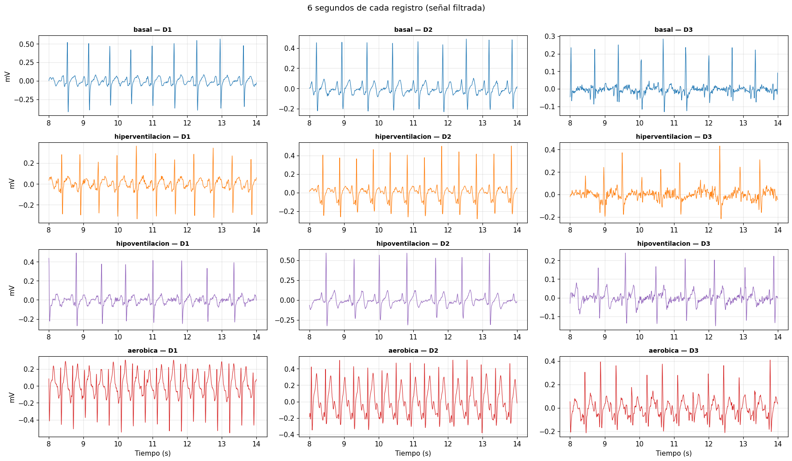
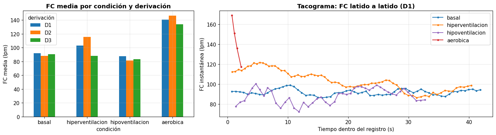
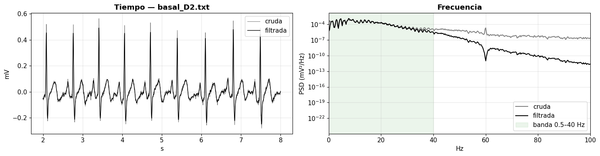
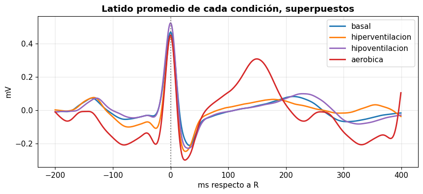
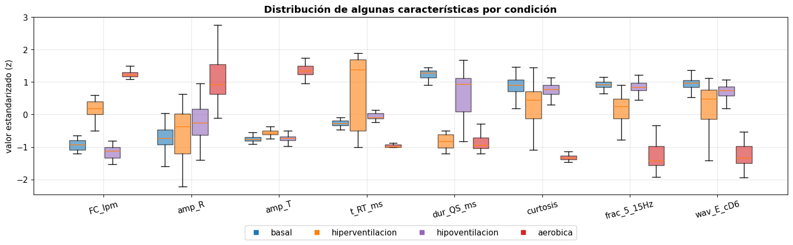
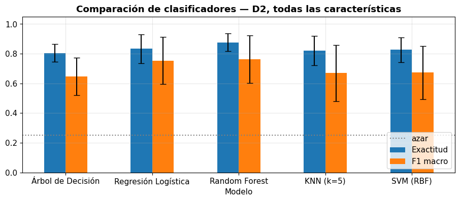
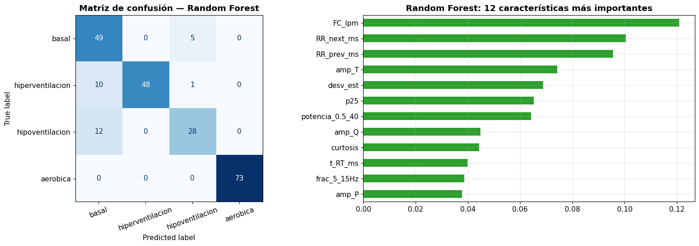

<h1 align="center">Extracción de Características para Clasificación de Señales ECG</h1>

<em>Laboratorio 11 — Introducción a Señales Biomédicas</em>

**Grupo 4 — 2026-II**  
**Integrantes:** 
- Solangel Macedo Pereria
- Astrid Sophia Mejía Barreto
- Geraldine Mayte Segura Villarreal
- José Vera Meza

## Índice

- [1. Introducción](#1-introducción)
- [2. Teoría de clase](#2-teoría-de-clase)
  - [2.1 Acondicionamiento y filtrado de la señal](#21-acondicionamiento-y-filtrado-de-la-señal)
  - [2.2 Extracción de características y machine learning](#22-extracción-de-características-y-machine-learning)
  - [2.3 Señal ECG: distancias y complejo QRS](#23-señal-ecg-distancias-y-complejo-qrs)
  - [2.4 Parámetros normales del electrocardiograma](#24-parámetros-normales-del-electrocardiograma)
  - [2.5 Familias de extracción de características](#25-familias-de-extracción-de-características)
- [3. Procedimiento](#3-procedimiento)
  - [3.1 Parte A — Conociendo los datos](#31-parte-a--conociendo-los-datos)
  - [3.2 Parte B — Extracción de características y clasificación](#32-parte-b--extracción-de-características-y-clasificación)
- [4. Resultados](#4-resultados)
  - [4.1 Parte A — Calidad de los registros y elección de derivación](#41-parte-a--calidad-de-los-registros-y-elección-de-derivación)
  - [4.2 Parte B — Características y clasificación](#42-parte-b--características-y-clasificación)
- [5. Cuestionario final](#5-cuestionario-final)
- [6. Conclusiones](#6-conclusiones)
- [7. Referencias](#7-referencias)

# 1. Introducción

En este laboratorio se procesó el ECG propio del grupo, registrado en las tres derivaciones de Einthoven (DI, DII, DIII) bajo cuatro condiciones fisiológicas (reposo, hiperventilación, hipoventilación y actividad aeróbica), para extraer características de cada latido y clasificarlos según la condición en que fueron registrados, siguiendo el flujo del artículo base (Subba y Chingtham, 2024).

**Objetivo:** extraer características morfológicas, estadísticas, de orden superior y espectrales (FFT y wavelet) de los latidos del ECG propio, y comparar el desempeño de cinco algoritmos de clasificación (Árbol de Decisión, Regresión Logística, Random Forest, KNN y SVM) para distinguir la condición fisiológica a partir de dichas características.

# 2. Teoría de clase

## 2.1 Acondicionamiento y filtrado de la señal

El acondicionamiento de la señal comprende el filtrado analógico, la amplificación y la adquisición de datos, previos al filtrado digital.

Para el filtrado digital se retoma lo visto en DSP: el uso de un circuito RC y el divisor de tensión, con el uso de impedancias. Usando el divisor de tensión para obtener $V_{out}$ a partir de $V_{in}$ y planteándolo en $s$ (con $s = j\omega$), se obtiene una función de transferencia de primer orden.

## 2.2 Extracción de características y machine learning

Como parte del procesamiento posterior al filtrado se encuentran las wavelets (extracción de características, *feature extraction*) y el machine learning, siguiendo el proceso CRISP-DM.

### Datos tabulares

Las características se pueden extraer de forma manual, organizándolas en una tabla, o de forma automática mediante machine learning. Para entender mejor los datos se pueden graficar hasta 2 o 3 características a la vez: por ejemplo, si se extraen 30 características, estas se pueden resumir a 2 o 3 mediante algoritmos de reducción de dimensión como **PCA** y **t-SNE**, visualizando así los patrones existentes. Al aplicar el modelo propiamente dicho (por ejemplo, una CNN de una dimensión), esto permite obtener una buena métrica.

## 2.3 Señal ECG: distancias y complejo QRS

Tradicionalmente se trabaja con hoja cuadriculada para medir distancias sobre la señal ECG; en la práctica esto lo usan más los cardiólogos y normalmente no se emplea en este curso. En su lugar, se puede usar la distancia entre picos R-R mediante la segunda derivada.

Otra característica es el complejo QRS, obtenido con el algoritmo phantom. La librería **NeuroKit** ya implementa este algoritmo para medir dichas distancias ([neuropsychology.github.io/NeuroKit/functions/ecg.html](https://neuropsychology.github.io/NeuroKit/functions/ecg.html)), y resume en sus funciones lo visto desde el inicio del curso sobre filtrado.

## 2.4 Parámetros normales del electrocardiograma

Al trabajar con una señal de ECG hay que verificar si los puntos característicos están dentro de rangos normales:

- **Intervalo PR prolongado (> 0.20 s):** puede indicar un bloqueo AV de primer grado.
- **Complejo QRS ensanchado (> 0.12 s):** sugiere un bloqueo de rama o arritmia ventricular.
- **Intervalo QT prolongado:** riesgo de torsades de pointes y otras arritmias.
- **Elevación del segmento ST:** puede indicar infarto agudo de miocardio.

Por ello, al trabajar con ECG conviene construir una tabla con las distancias de los distintos puntos y verificar que se encuentren en el rango normal. Además, para obtener información completa del paciente es necesario visualizar las 12 derivaciones.

## 2.5 Familias de extracción de características

Dentro de feature extraction se trabajan las siguientes familias:

- Estadísticas de orden superior (HOS).
- Extracción de características morfológicas (dominio temporal).
- CWT (transformada wavelet continua) y STFT (transformada de Fourier de tiempo corto).

# 3. Procedimiento

El procedimiento se organizó en dos partes: primero se revisaron los registros y se eligió una derivación; luego se procesaron sus latidos, se calcularon características y se compararon clasificadores.

## 3.1 Parte A — Conociendo los datos

1. **Inventario y conversión:** se cargaron los 12 registros de OpenSignals, correspondientes a las derivaciones DI, DII y DIII en las condiciones basal, hiperventilación, hipoventilación y aeróbica. Se revisaron los metadatos, los paquetes perdidos y las muestras saturadas. Los valores del ADC se convirtieron a milivoltios con la ecuación del sensor ECG de BITalino.
2. **Inspección y control de calidad:** se visualizaron seis segundos de cada señal para comparar la polaridad del QRS y detectar artefactos. Se identificó automáticamente la polaridad, se detectaron los picos R con una implementación simplificada de Pan-Tompkins y se marcaron como anómalos los intervalos RR que se alejaban más del 35 % de la mediana local. También se calculó la frecuencia cardiaca media por condición y derivación.
3. **Selección de derivación:** se eligió DII porque contenía las cuatro condiciones, mantenía el QRS positivo y presentaba menos problemas de calidad que DI y DIII.

## 3.2 Parte B — Extracción de características y clasificación

1. **Filtrado y detección de latidos:** en DII se centraron las señales y se aplicó un filtro Butterworth pasa-banda de 0.5–40 Hz, seguido de un filtro *notch* de 60 Hz. Para detectar cada pico R se usó un pasa-banda de 5–15 Hz, derivación, elevación al cuadrado, integración móvil de 150 ms y un umbral con periodo refractario.
2. **Segmentación:** se conservaron los latidos con intervalos RR válidos y una ventana completa de 200 ms antes y 400 ms después del pico R. Se descartaron el primer y el último latido de cada registro, además de los latidos con intervalos anómalos.
3. **Extracción de características:** se describió cada latido mediante 24 características de cinco familias: ritmo, morfología, estadísticas básicas y de orden superior, y frecuencia. Estas últimas incluyeron parámetros de FFT y energías relativas de cuatro niveles de la transformada wavelet discreta db4.
4. **Clasificación y evaluación:** se compararon Árbol de Decisión, Regresión Logística, Random Forest, KNN y SVM usando exactitud y F1 macro. La validación se realizó en tres pliegues, agrupando los latidos por bloques de 10 s para evitar que latidos consecutivos de un mismo bloque quedaran simultáneamente en entrenamiento y prueba.

# 4. Resultados

## 4.1 Parte A — Calidad de los registros y elección de derivación

Se encontraron los 12 archivos esperados, con datos reales del grupo. La inspección visual mostró QRS positivo en la mayoría de los registros; el QRS de la condición aeróbica en DI fue negativo y se invirtió para el análisis. La revisión de saturación e intervalos RR dio los siguientes resultados:

 <em>Fig. 1. Seis segundos de los registros ECG filtrados por condición y derivación.</em>

| Derivación | Registros que requieren revisión | Evaluación general |
|---|---|---|
| DI | Aeróbica: 55.6 % de RR anómalos y 274 muestras saturadas; 10 latidos detectados y 2 válidos | Un registro problemático |
| DII | Hipoventilación: 2.3 % de RR anómalos; sin saturación | Tres registros buenos y uno para revisar |
| DIII | Basal: 1.8 % de RR anómalos; hiperventilación: 39.4 %; hipoventilación: 15.8 %; aeróbica: 19.0 % | Un registro para revisar y tres problemáticos |

Se seleccionó DII: presentó menos registros problemáticos que las otras derivaciones, conservó el QRS positivo en las cuatro condiciones y permitió trabajar con los cuatro grupos. La frecuencia cardiaca media calculada para esta derivación fue:

| Condición | Latidos válidos | RR anómalos | Frecuencia cardiaca media |
|---|---:|---:|---:|
| Basal | 54 | 0.0 % | 88.2 lpm |
| Hiperventilación | 59 | 0.0 % | 115.5 lpm |
| Hipoventilación | 40 | 2.3 % | 81.4 lpm |
| Aeróbica | 73 | 0.0 % | 146.4 lpm |

La frecuencia cardiaca fue mayor en la condición aeróbica, seguida por hiperventilación, basal e hipoventilación. Este orden es consistente con el aumento esperado durante la actividad física. Los registros aeróbicos de las tres derivaciones se tomaron en momentos diferentes, por lo que sus frecuencias cardiacas no son mediciones simultáneas.

 <em>Fig. 2. Frecuencia cardiaca media por condición y derivación (izquierda) y tacograma de la derivación DI (derecha), calculados con intervalos RR no anómalos.</em>

## 4.2 Parte B — Características y clasificación

En DII, el detector encontró 56, 61, 44 y 75 latidos en las condiciones basal, hiperventilación, hipoventilación y aeróbica, respectivamente. Después del control de calidad y la segmentación se conservaron **226 latidos** de 600 muestras cada uno: 54 basales, 59 de hiperventilación, 40 de hipoventilación y 73 aeróbicos. De cada latido se calcularon 24 características.

 <em>Fig. 3. Comparación temporal y espectral de un registro ECG antes y después del filtrado.</em>

 <em>Fig. 4. Latido promedio de cada condición en DII, alineado por el pico R.</em>

La frecuencia cardiaca y la fracción de energía entre 5 y 15 Hz destacaron al comparar las condiciones. La condición aeróbica presentó la mayor frecuencia cardiaca media (146.5 lpm en los latidos segmentados) y una amplitud media de onda T mayor que las otras condiciones. Los latidos basales e hipoventilados mostraron características más parecidas entre sí.

 <em>Fig. 5. Distribución de características seleccionadas por condición; los valores están estandarizados para facilitar su comparación.</em>

La validación agrupada produjo los siguientes resultados:

| Modelo | Exactitud | F1 macro |
|---|---:|---:|
| Árbol de Decisión | 0.805 ± 0.060 | 0.646 ± 0.126 |
| Regresión Logística | 0.834 ± 0.097 | 0.754 ± 0.158 |
| Random Forest | 0.877 ± 0.061 | 0.764 ± 0.160 |
| KNN (k = 5) | 0.821 ± 0.099 | 0.669 ± 0.190 |
| SVM (RBF) | 0.826 ± 0.083 | 0.674 ± 0.179 |

 <em>Fig. 6. Comparación del desempeño de los cinco clasificadores con validación por bloques.</em>

Random Forest obtuvo el mayor F1 macro (0.764), seguido de Regresión Logística (0.754). La diferencia entre ambos fue pequeña frente a la variación entre pliegues, por lo que estos resultados no permiten afirmar que Random Forest sea claramente superior. La matriz de confusión mostró que los errores más frecuentes ocurrieron entre las clases basal e hipoventilación, coherente con la similitud observada en sus características.

 <em>Fig. 7. Matriz de confusión del mejor modelo e importancia de características estimada por Random Forest.</em>

La validación también afectó sustancialmente la métrica: para Random Forest sin características de ritmo, el F1 macro fue 0.940 al mezclar latidos al azar, pero 0.615 al separarlos por bloques de 10 s. El primer valor es optimista porque latidos cercanos pueden compartir características y aparecer en entrenamiento y prueba. Por ello, se reportan como referencia principal los resultados de la validación por bloques.

# 5. Cuestionario final

### Pregunta 1 — ¿Qué derivación funciona mejor?
Ejecuta `experimento("D1")`, `experimento("D2")` y `experimento("D3")`. ¿Con qué derivación y qué modelo obtienes el mejor F1? ¿Coincide con la calidad que viste en la Parte A?

### Pregunta 2 — ¿Importa la polaridad?
En **D2**, compara `experimento("D2", invertir="auto")` con `experimento("D2", invertir=False)`. ¿Cambia el número de latidos detectados? Usando la tabla devuelta (`res, tab, resumen = experimento(...)`), compara el promedio de `amp_R` y `amp_S`. ¿Qué onda está midiendo realmente `amp_R` en cada caso? ¿Cambia el F1?

### Pregunta 3 — Pares de condiciones: ¿cuál es más difícil de distinguir?
En tu derivación, clasifica solo **dos** condiciones: `["basal", "aerobica"]` y `["basal", "hiperventilacion"]`. Para cada par, compara todas las características con `columnas=RITMO`. ¿Qué par es más difícil y por qué?

### Pregunta 4 — Sensibilidad del detector
Cambia `factor_umbral` a **0.1**, **0.3** y **0.7**. ¿Cómo cambian los latidos detectados y válidos en el archivo con más problemas de calidad (Parte A)? ¿Qué valor elegirías y por qué?

### Pregunta 5 — ¿Cuántas características necesitamos?
Usa solo las **5 características más importantes** del Random Forest (gráfico de B.7), por ejemplo `columnas=imp.tail(5).index.tolist()`. ¿El F1 baja mucho respecto a las 24? ¿Qué ventaja práctica tendría usar menos características?

**Respuestas:**
### Pregunta 1 — ¿Qué derivación funciona mejor?
Se obtiene el mejor F1 con la tercera derivación y el modelo Random Forest (0.806), mayor que con la segunda derivación y el modelo Random Forest (0.764). Sin embargo, la tercera derivación presenta mayor cantidad de % RR anómalos en sus cuatro condiciones; en cambio, la segunda derivación solo presenta un % RR anómalo en hipoventilación, de 2.3 %, mucho menor que en la tercera derivación (1.8 %, 39.4 %, 15.8 % y 19.0 %).

### Pregunta 2 — ¿Importa la polaridad?
Al comparar `experimento("D2", invertir="auto")` con `experimento("D2", invertir=False)`, no cambia el número de latidos detectados; se mantiene igual. Los promedios de amp_R y amp_S también se mantienen iguales. En ambos casos, amp_R está midiendo el valor del pico R. El F1 se mantiene igual, con 0.431 en el modelo Árbol de Decisión.

### Pregunta 3 — Pares de condiciones: ¿cuál es más difícil de distinguir?
El par más difícil de distinguir es basal e hiperventilación, ya que su mejor F1 es 0.860, con Regresión Logística; en cambio, el par basal y aeróbica tiene una puntuación perfecta de 1.0 en todos los modelos.

### Pregunta 4 — Sensibilidad del detector
El archivo con más problemas de calidad es la tercera derivación, como verificamos en la Parte A. A mayor factor umbral, disminuyen considerablemente los latidos detectados y válidos: se pasa de 54 latidos válidos con un factor umbral de 0.1 a 6 latidos válidos con un factor umbral de 0.7. Elegiría el factor umbral de 0.1 porque tiene el mayor número de latidos válidos y disminuye el % RR anómalo.

### Pregunta 5 — ¿Cuántas características necesitamos?
Con 24 características, el mayor valor de F1 es 0.764, con Random Forest. Por otro lado, con 5 características, el valor de F1 disminuye a 0.736, también con Random Forest. Es una diferencia de 0.028. Al usar menos características, se disminuyen el costo computacional, así como el del procesamiento de señal.

# 6. Conclusiones

La revisión de los registros permitió elegir DII por su QRS positivo y mejor calidad general. La frecuencia cardiaca fue mayor en la condición aeróbica. El procesamiento produjo 226 latidos con 24 características; la frecuencia cardiaca y la energía entre 5–15 Hz ayudaron a distinguir condiciones, aunque basal e hipoventilación fueron similares.

Random Forest obtuvo el mayor F1 macro (0.764), con resultados cercanos a Regresión Logística. La validación por bloques evitó estimaciones optimistas por fuga de información. Como se analizó una sola persona y hubo registros con saturación o intervalos anómalos, los resultados describen esta sesión y no deben generalizarse clínicamente.

# 7. Referencias

1. T. Subba y T. Chingtham, "Comparative Analysis of Machine Learning Algorithms With Advanced Feature Extraction for ECG Signal Classification", *IEEE Access*, 2024. doi: 10.1109/ACCESS.2024.3387041
2. J. Pan y W. J. Tompkins, "A Real-Time QRS Detection Algorithm", *IEEE Trans. Biomed. Eng.*, vol. BME-32, no. 3, pp. 230–236, 1985.
3. PLUX Wireless Biosignals, *BITalino (r)evolution — ECG Sensor Datasheet* (fórmula de conversión).
4. L. Sörnmo y P. Laguna, *Bioelectrical Signal Processing in Cardiac and Neurological Applications*, Elsevier, 2005.
5. NeuroKit2 — documentación de funciones ECG: [neuropsychology.github.io/NeuroKit/functions/ecg.html](https://neuropsychology.github.io/NeuroKit/functions/ecg.html)
6. *[Agregar cualquier otra referencia citada en el análisis]*
