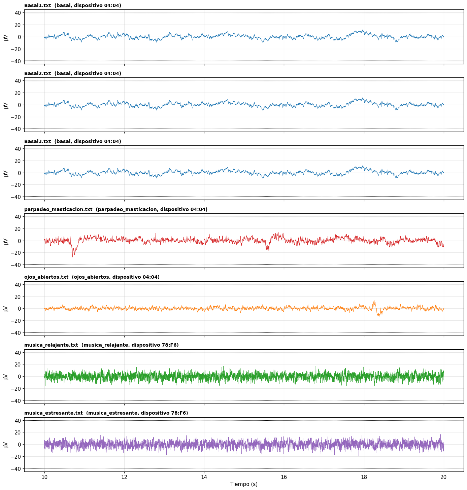
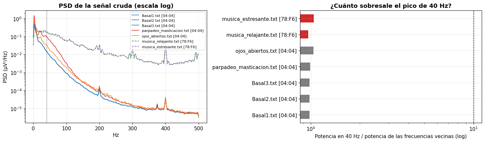
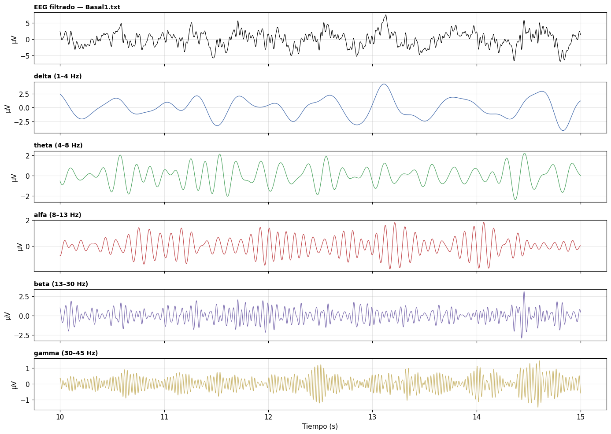
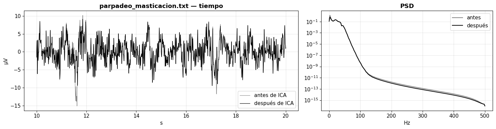
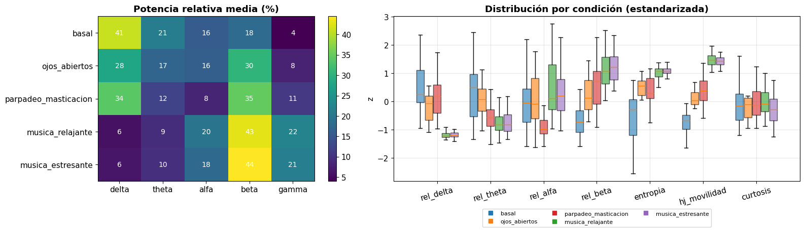
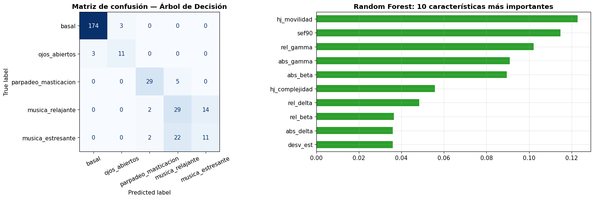

<h1 align="center">Tratamiento de la señal EEG, ritmos cerebrales, filtro ICA y extracción de características</h1>

<em>Laboratorio 12 — Introducción a Señales Biomédicas</em>

**Grupo 4 — 2026-II**  
**Integrantes:** 
- Solangel Macedo Pereria
- Astrid Sophia Mejía Barreto
- Geraldine Mayte Segura Villarreal
- José Vera Meza

## Índice

- [1. Introducción](#1-introducción)
- [2. Teoría de clase](#2-teoría-de-clase)
- [3. Procedimiento](#3-procedimiento)
  - [3.1 Preparación y filtrado de las señales](#31-preparación-y-filtrado-de-las-señales)
  - [3.2 ICA, extracción de características y clasificación](#32-ica-extracción-de-características-y-clasificación)
- [4. Resultados](#4-resultados)
  - [4.1 Calidad y filtrado](#41-calidad-y-filtrado)
  - [4.2 Características y clasificación](#42-características-y-clasificación)
- [5. Cuestionario final](#5-cuestionario-final)
- [6. Conclusiones](#6-conclusiones)
- [7. Referencias](#7-referencias)

# 1. Introducción

El electroencefalograma (EEG) es una técnica no invasiva que registra la actividad eléctrica del cerebro mediante electrodos colocados sobre el cuero cabelludo. Su principal ventaja es la resolución temporal, es útil para estudiar el sueño, la carga cognitiva, la epilepsia y las interfaces cerebro-computadora (BCI) [1]. No obstante, la señal es de apenas unos microvoltios y está expuesta a artefactos de mayor amplitud que la actividad cerebral, por lo que requiere un procesamiento cuidadoso antes de ser interpretada.

En este laboratorio se procesa las señales EEG adquiridas en el LAB 06 con el sistema BITalino bajo diferentes condiciones:lectura basal, mirada fija en un punto (ojos abiertos), apertura y cierre de ajos, música relajante y estresante. El objetivo es limpiar las señales EEG, analizar sus ritmos cerebrales y de este manera, extraer características que permitan distinguir el estado de la persona. 

# 2. Teoría de clase

## 2.1 Origen y características de la señal EEG

El EEG refleja la suma de potenciales postsinápticos que ocurren de forma sincronizada en poblaciones de neuronas piramidales de la corteza cerebral [1]. Un electrodo no capta neuronas individuales, sino la actividad coherente de grandes grupos. Antes de llegar al sensor, la señal atraviesa meninges, líquido cefalorraquídeo, cráneo y piel; por ello, su amplitud es muy pequeña, del orden de microvoltios [2].

Asimismo, el EEG es una señal no estacionaria. A diferencia del ciclo P-QRS-T del ECG, que se repite con una morfología casi constante, sus propiedades estadísticas cambian en el tiempo según la actividad mental. Por ello, se analiza en ventanas cortas en las que la señal puede considerarse casi estacionaria [3].

## 2.2 Bandas de frecuencia del EEG

Separar la señal por bandas permite asociar cada rango de oscilación con un estado funcional distinto [4].

| Banda | Frecuencia (Hz) | Asociación típica |
|-------|-----------------|-------------------|
| Delta | 0.5 – 4 | Sueño profundo |
| Theta | 4 – 8 | Somnolencia, carga cognitiva |
| Alfa | 8 – 12 | Relajación con ojos cerrados; se suprime al abrir los ojos o con actividad mental |
| Beta | 12 – 25 | Mente activa, concentración |
| Gamma | > 25 | Integración sensorial y percepción consciente |

## 2.3 Artefactos

Los artefactos son señales no cerebrales que contaminan el registro y suelen superar en amplitud al EEG [5]:

- **Ocular (EOG):** parpadeos y movimientos oculares; afectan sobre todo a los canales frontales y se confunden con actividad lenta (delta/theta).
- **Muscular (EMG):** contracción de mandíbula, cara y cuello; aporta energía de alta frecuencia que contamina beta y gamma.
- **Cardíaco (ECG):** espigas periódicas asociadas al latido.
- **Red eléctrica:** interferencia a 60 Hz en Perú.

## 2.4 Preprocesamiento y filtrado

Se usan filtros pasa-altas (0.5–1 Hz, elimina la deriva de línea base), pasa-bajas (40–45 Hz, recorta el ruido muscular y térmico) y notch (60 Hz, rechaza la red eléctrica). En EEG se aplica filtrado de fase cero para evitar retardos temporales en la señal [6].

Cuando el artefacto comparte banda con el EEG (por ejemplo, parpadeos y ondas delta/theta), un filtro en frecuencia no basta y se usa el análisis de componentes independientes (ICA), que separa la señal en fuentes independientes para eliminar las de origen no cerebral [7]. Los filtros espaciales CAR (resta el promedio de todos los electrodos) y Laplaciano (resta el promedio de los vecinos) requieren varios canales [8].

## 2.5 Densidad espectral de potencia (PSD)

La PSD indica cómo se distribuye la potencia de la señal en cada frecuencia (µV²/Hz). Una FFT simple de todo el registro es un estimador ruidoso, por lo que se usa el método de Welch [9]: se divide la señal en segmentos superpuestos, se aplica una ventana a cada uno, se calcula la FFT, se obtiene el periodograma modificado y se promedian los periodogramas, lo que reduce la varianza del espectro.

Para visualizarla se expresa en decibelios, ya que las frecuencias lentas tienen mucha más potencia que las rápidas y en escala lineal estas últimas quedarían ocultas:

$$P_{dB}(\omega) = 10 \log_{10}\big(P(\omega)\big)$$

## 2.6 Extracción de características para Machine Learning

Dar al clasificador miles de puntos crudos (canales × frecuencia de muestreo × tiempo) provoca sobreajuste, por lo que se comprime cada ventana en un vector compacto de descriptores [10]. Las características se agrupan en cinco dominios [11]:

| Dominio | Pregunta que responde | Ejemplos |
|---|---|---|
| Tiempo | ¿Qué amplitud o forma tiene la onda? | Media, varianza, cruces por cero, parámetros de Hjorth |
| Frecuencia | ¿Cuánta energía hay en cada ritmo? | Potencia absoluta y relativa (Welch) |
| Tiempo-frecuencia | ¿Cuándo ocurre un cambio de frecuencia? | Wavelets (DWT, CWT), STFT |
| Espacial / red | ¿Qué zonas se activan o sincronizan? | CSP, coherencia, PLV, PLI |
| No lineal | ¿Qué tan compleja es la señal? | Entropía diferencial, entropía muestral, dimensión fractal de Higuchi |

# 3. Procedimiento

## 3.1 Parte A - Conociendo nuestros datos

1. **Lectura y conversión:** se cargaron siete registros de un participante: tres basales, ojos abiertos, parpadeo y masticación, música relajante y música estresante. Se identificó el canal EEG en cada archivo y se convirtieron las cuentas del ADC de 10 bits a microvoltios con la fórmula del sensor BITalino. También se revisaron frecuencia de muestreo, paquetes perdidos y muestras saturadas.
2. **Inspección de calidad:** se compararon diez segundos de cada señal y se calculó la densidad espectral de potencia con el método de Welch. Se buscaron muestras saturadas, picos estrechos y componentes de alta amplitud que pudieran corresponder a artefactos.
3. **Filtrado:** según los parámetros del cuaderno, se descartaron los primeros cuatro segundos, se aplicó un Butterworth pasa-banda de 1–45 Hz con filtrado de fase cero, un notch configurado en 40 Hz y filtros notch adicionales en las líneas estrechas detectadas para cada registro. Las épocas que contenían muestras saturadas se excluyeron.

## 3.2 Parte B - Tratamiento y extracción de características

1. **Reducción de artefactos:** para el ICA de un canal, se descompuso cada señal en seis sub-bandas wavelet que se trataron como canales virtuales. Se calcularon métricas de las componentes; las asociadas a transitorios se corrigieron mediante umbralado wavelet y las identificadas como interferencia se eliminaron.
2. **Segmentación y características:** se dividieron las señales limpias en épocas de dos segundos, sin normalización por registro. Cada época se describió con 22 características temporales, espectrales y de complejidad: potencia absoluta y relativa por banda, frecuencia pico, SEF90, entropía, parámetros de Hjorth, desviación estándar, asimetría, curtosis y amplitud pico a pico, entre otras.
3. **Clasificación:** se compararon Árbol de Decisión, Regresión Logística, Random Forest, KNN (k = 5) y SVM con kernel RBF. Se estandarizaron las características dentro de cada modelo y se usó validación cruzada estratificada de tres pliegues, agrupando las épocas por registro y bloques de diez segundos para reducir la fuga entre épocas cercanas.

# 4. Resultados

## 4.1 Calidad y filtrado

Las salidas guardadas muestran siete registros sin paquetes perdidos. La tabla de lectura indica 1000 Hz para todos; registra 32 muestras saturadas en ojos abiertos (0.1 %) y ninguna en los demás archivos. La inspección espectral guardada no muestra un pico destacado en 40 Hz (razón de potencia de 1.0 en los siete registros).

 <em>Fig. 1. Señales crudas de los siete registros; las líneas punteadas indican el rango del sensor.</em>

 <em>Fig. 2. PSD de las señales crudas y comparación de la potencia próxima a 40 Hz.</em>

Después del filtrado se visualizaron la señal y sus ritmos. La música relajante y la estresante presentan distribuciones de potencia relativas similares: en ambas domina beta (42.9 % y 44.5 %, respectivamente), seguida por gamma (22.1 % y 21.4 %). La relajante muestra una proporción alfa algo mayor (19.6 % frente a 17.8 %). Estas diferencias son descriptivas y no demuestran por sí solas una diferencia estadísticamente significativa entre las condiciones.

 <em>Fig. 3. Descomposición de un registro basal filtrado en las bandas delta, theta, alfa, beta y gamma.</em>

**Inconsistencia que requiere verificación:** el texto explicativo del cuaderno asume un muestreo de 100 Hz y atribuye a aliasing de 60 Hz un componente en 40 Hz; en cambio, sus salidas guardadas indican 1000 Hz y una razón de potencia en 40 Hz de 1.0. También difieren algunos resultados de calidad descritos en el texto del cuaderno y los de las celdas ejecutadas. Por ello, el notch de 40 Hz y las cifras anteriores deben confirmarse volviendo a ejecutar el notebook con los archivos originales antes de interpretar este pico como alias de la red eléctrica.

## 4.2 Características y clasificación

El ICA trató componentes asociados a transitorios en los siete registros. En el ejemplo de parpadeo y masticación, la salida reporta una reducción de varianza de 31.2 % después del procesamiento; este cambio ilustra el efecto del método en ese registro, pero no equivale por sí mismo a una mejora de clasificación.

 <em>Fig. 4. Señal y PSD de parpadeo y masticación antes y después del procesamiento ICA.</em>

Se obtuvieron **305 épocas** y **22 características**: 177 basales, 14 de ojos abiertos, 34 de parpadeo y masticación, 45 de música relajante y 35 de música estresante. La cantidad desigual de épocas —en particular, las 14 de ojos abiertos— debe considerarse al comparar las métricas. La visualización muestra diferencias entre condiciones en las potencias de banda y en las características estandarizadas, aunque hay solapamiento entre varias clases.

 <em>Fig. 5. Potencia relativa media por banda y distribución de características seleccionadas, estandarizadas para compararlas.</em>

La validación agrupada produjo los siguientes resultados:

| Modelo | Exactitud | F1 macro |
|---|---:|---:|
| Árbol de Decisión | 0.833 | 0.689 ± 0.060 |
| Regresión Logística | 0.826 | 0.648 ± 0.025 |
| Random Forest | 0.823 | 0.670 ± 0.026 |
| KNN (k = 5) | 0.816 | 0.599 ± 0.047 |
| SVM (RBF) | 0.826 | 0.589 ± 0.050 |

El Árbol de Decisión obtuvo el mayor F1 macro (0.689), seguido de Random Forest (0.670). Sin embargo, la matriz de confusión muestra errores entre las dos clases de música: de las épocas relajantes, 14 se clasificaron como estresantes; de las estresantes, 22 se clasificaron como relajantes. Además, el conjunto está desbalanceado y el cuaderno permite predecir el dispositivo de registro con un F1 macro cercano a 0.98. Como las condiciones no están distribuidas de forma uniforme entre los dos dispositivos, parte del desempeño podría deberse a diferencias de equipo y no al estado registrado; por tanto, estas métricas no deben interpretarse como evidencia de generalización clínica.

 <em>Fig. 6. Matriz de confusión del Árbol de Decisión y diez características más importantes del Random Forest.</em>

# 5. Cuestionario final
### Pregunta 1 — ¿Se distingue la música relajante de la estresante?
Ambas se grabaron con el mismo equipo (2A:08), con 2 minutos de diferencia. El F1 macro va de 0.450 (Random Forest) a 0.572 (KNN), con mucha variación entre pliegues (± 0.046 a 0.137). Con dos clases, un F1 cercano a 0.5 equivale al azar, así que no hay una separación fiable entre ambas músicas.

Las bandas cambian poco: la relajante tiene más alfa (19.6 % vs. 17.8 %) y algo más de gamma (22.1 % vs. 21.4 %), mientras que la estresante tiene más beta (44.5 % vs. 42.9 %), delta (6.4 % vs. 5.9 %) y theta (9.6 % vs. 9.3 %). Por eso la relación alfa/beta es mayor en la relajante (0.501 vs. 0.425), y la entropía (0.875 vs. 0.882) y theta/beta (0.227 en ambas) prácticamente no varían. La frecuencia pico sí difiere (17.1 Hz en la relajante vs. 12.6 Hz en la estresante).

Las diferencias son de 1 a 2 puntos porcentuales y no hay una prueba estadística que indique si superan la variabilidad entre épocas. Beta y gamma suman cerca de dos tercios de la potencia en ambas, lo que sugiere contaminación muscular o ruido de alta frecuencia y no solo actividad cerebral. Además, la estresante necesitó más correcciones de transitorios (4 vs. 2 ICs) y conservó menos épocas (35 vs. 45), lo que apunta a más artefactos en esa grabación. Al ser una sola grabación por música, no se puede generalizar.

### Pregunta 2 — ¿Ayuda el ICA?

| Configuración | Mejor F1 (modelo) | Épocas de parpadeo | Curtosis media | Pico a pico medio (µV) |
|---|---|---|---|---|
| Con ICA, rechazando saturadas | 0.572 (KNN) | — | — | — |
| Sin ICA, rechazando saturadas | 0.575 (KNN) | — | — | — |
| Con ICA, **sin** rechazar saturadas | 0.572 (KNN) | — | — | — |
| Sin ICA, **sin** rechazar saturadas | 0.575 (KNN) | — | — | — |

- **En el par de músicas, el ICA no cambia el F1.** Las diferencias entre configuraciones son de 0.003 a 0.013 (por ejemplo, Árbol de Decisión 0.532 con ICA vs. 0.519 sin ICA), muy por debajo de la variación entre pliegues (± 0.046 a 0.137). Además, con F1 ≈ 0.5 ninguna configuración separa las clases mejor que el azar.
- **Rechazar o no saturadas tampoco cambia el F1:** los valores son idénticos en ambos casos.
- **No se puede evaluar el efecto del ICA sobre parpadeos y masticación,** porque esos datos no se cargaron.

**Conclusión:** con los datos disponibles no se puede responder cuándo se nota más el efecto del ICA. Teóricamente debería notarse más cuando no se descartan las épocas con artefactos, porque el ICA corrige transitorios estereotipados como los parpadeos que de otro modo permanecerían en la señal.

### Pregunta 3 — ¿Qué pasa si no quitamos las interferencias?

### Pregunta 4 — Normalizar, ¿ayuda o perjudica?

### Pregunta 5 — Duración de la época

# 6. Conclusiones

# 7. Referencias

[1] Lotte, F., Bougrain, L., Cichocki, A., et al. (2018). A review of classification algorithms for EEG-based brain–computer interfaces: a 10 year update. *Journal of Neural Engineering*, 15(3), 031005. https://doi.org/10.1088/1741-2552/aab2f2

[2] Nunez, P. L., & Srinivasan, R. (2006). *Electric Fields of the Brain: The Neurophysics of EEG* (2.ª ed.). Oxford University Press.

[3] Kaplan, A. Y., Fingelkurts, A. A., Fingelkurts, A. A., Borisov, S. V., & Darkhovsky, B. S. (2005). Nonstationary nature of the brain activity as revealed by EEG/MEG. *Signal Processing*, 85(11), 2190–2212.

[4] Klimesch, W. (1999). EEG alpha and theta oscillations reflect cognitive and memory performance: a review and analysis. *Brain Research Reviews*, 29(2–3), 169–195.

[5] Urigüen, J. A., & Garcia-Zapirain, B. (2015). EEG artifact removal—state-of-the-art and guidelines. *Journal of Neural Engineering*, 12(3), 031001.

[6] Widmann, A., Schröger, E., & Maess, B. (2015). Digital filter design for electrophysiological data. *Journal of Neuroscience Methods*, 250, 34–46.

[7] Makeig, S., Bell, A. J., Jung, T.-P., & Sejnowski, T. J. (1996). Independent component analysis of electroencephalographic data. *Advances in Neural Information Processing Systems 8*, 145–151.

[8] McFarland, D. J., McCane, L. M., David, S. V., & Wolpaw, J. R. (1997). Spatial filter selection for EEG-based communication. *Electroencephalography and Clinical Neurophysiology*, 103(3), 386–394.

[9] Welch, P. D. (1967). The use of fast Fourier transform for the estimation of power spectra. *IEEE Transactions on Audio and Electroacoustics*, 15(2), 70–73.

[10] Jenke, R., Peer, A., & Buss, M. (2014). Feature extraction and selection for emotion recognition from EEG. *IEEE Transactions on Affective Computing*, 5(3), 327–339.

[11] Boonyakitanont, P., Lek-uthai, A., Chomtho, K., & Songsiri, J. (2020). A review of feature extraction and performance evaluation in epileptic seizure detection using EEG. *Biomedical Signal Processing and Control*, 57, 101702.
