# Detección de fatiga muscular mediante sEMG

**Proyecto privado:** [fatiga-semg-grupo4](https://studio.edgeimpulse.com/studio/1171872)

## Índice

- [1. Datos y control de integridad](#1-datos-y-control-de-integridad)
- [2. Configuración y estado en Edge Impulse](#2-configuración-y-estado-en-edge-impulse)
- [3. Resultados y tabla de métricas](#3-resultados-y-tabla-de-métricas)
  - [3.1 Validación interna](#31-validación-interna)
  - [3.2 Prueba independiente (Model Testing)](#32-prueba-independiente-model-testing)
  - [3.3 Desempeño estimado en el dispositivo objetivo](#33-desempeño-estimado-en-el-dispositivo-objetivo)
- [4. Interpretación y limitaciones](#4-interpretación-y-limitaciones)
- [5. Conclusiones](#5-conclusiones)

## 1. Datos y control de integridad

El objetivo fue evaluar una CNN 1D capaz de distinguir repeticiones de curl de bíceps con y sin fatiga a partir de un canal de electromiografía superficial. El protocolo del equipo incluyó reposo, MVC antes y después del ejercicio y registro del esfuerzo percibido con OMNI-RES. Según la guía, la clase fatiga corresponde al nivel 2 de Cerqueira y a OMNI-RES 9 en los sujetos del laboratorio.

| Conjunto | Origen | Sin fatiga | Con fatiga | Total |
|---|---|---:|---:|---:|
| Training | Cerqueira, 13 sujetos (C01–C13) | 989 | 762 | 1751 |
| Testing | BITalino, 4 sujetos (S01–S04) | 89 | 64 | 153 |

Se verificaron los 1904 CSV. Todos contienen las columnas timestamp y emg, 4000 valores numéricos finitos y tiempos enteros consecutivos de 0 a 3999 ms. El intervalo de 1 ms corresponde a 1000 Hz. Los 3999 ms son el tiempo entre la primera y la última muestra, y 4000 ms es la duración de la ventana de 4000 puntos a 1000 Hz. Se comprobó la unicidad del identificador de repetición y de la secuencia EMG mediante SHA-256. El inventario detalla la revisión por archivo.

El filtrado previo de 20–450 Hz y las unidades en mV se consignan según la guía del equipo. La auditoría del ZIP verifica la estructura de las señales y las etiquetas de los nombres. Para contrastar cada etiqueta con el criterio experimental harían falta los registros de etiquetado originales.

## 2. Configuración y estado en Edge Impulse

Edge Impulse mostró 1751 registros en Training y 153 en Test. La carga se realizó por separado con etiquetas inferidas del nombre de archivo y con la división automática desactivada. El CSV Wizard quedó configurado para series temporales con timestamp en milisegundos, un canal emg y un registro por archivo.

| Parámetro | Valor |
|---|---|
| Canal | emg |
| Frecuencia detectada | 1000 Hz |
| Tamaño y paso de ventana | 4000 ms y 4000 ms, respectivamente |
| Relleno con ceros | Activado en el editor del impulso |
| Procesamiento | Raw Data |
| Bloque de aprendizaje | Classification, modo Expert (Keras) según la guía |
| CNN 1D | Conv1D de 16, 32 y 32 filtros, kernels 25, 9 y 9, batch normalization y max pooling de factor 4 en los dos primeros bloques, global average pooling, dropout 0.3, capa densa de 16 y softmax de 2 clases |
| Tasa de aprendizaje y épocas | 0.001 y 30 épocas |
| Estado | Características generadas, CNN entrenada y Model Testing completado en Float32. |

El archivo CNN1D_Keras.py contiene la arquitectura utilizada en la plantilla Expert. Se configuró Adam, batch size de 32 y una validación interna del 20 %. En las gráficas se observa que la exactitud de entrenamiento aumenta hasta aproximadamente 85 %, mientras que la validación fluctúa, con un incremento notable de la pérdida alrededor de la época 24. La proyección del Feature explorer muestra superposición entre las clases.

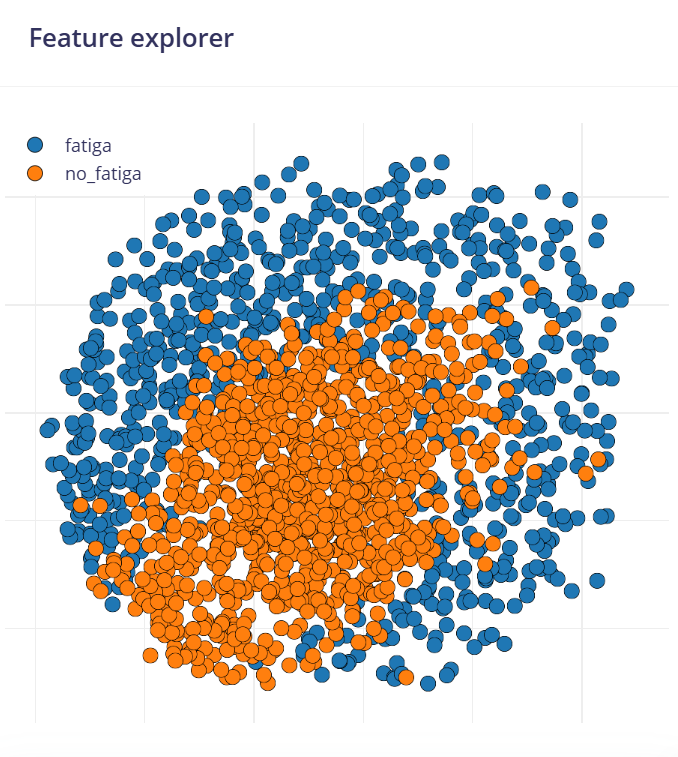 <em>Fig. 1. Feature explorer del conjunto de entrenamiento.</em>

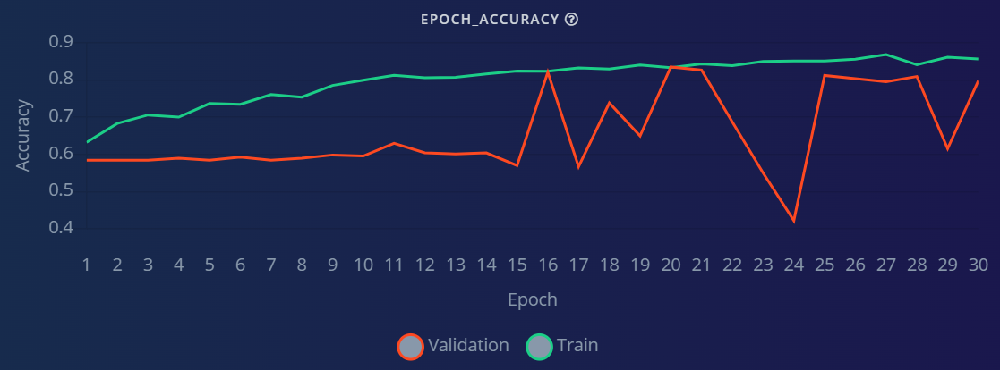 <em>Fig. 2. Exactitud de entrenamiento y validación por época.</em>

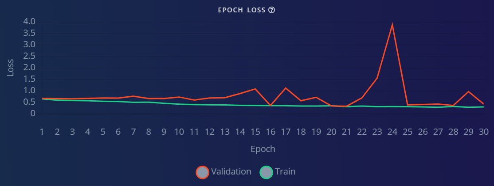 <em>Fig. 3. Pérdida de entrenamiento y validación por época.</em>

## 3. Resultados y tabla de métricas

| Evaluación | Exactitud | Exactitud balanceada | AUC | Precisión ponderada | Recall ponderado | F1 ponderado |
|---|---:|---:|---:|---:|---:|---:|
| Validación interna Float32 | 82.6 % | 83.35 % | 0.83 | 0.84 | 0.83 | 0.83 |
| Validación interna INT8 | 58.4 % | 50 % | 0.50 | 0.34 | 0.58 | 0.43 |
| Model Testing Float32 (153 repeticiones) | 34.64 % | 39.45 % | 0.51 | 0.52 | 0.46 | 0.41 |
| CNN previa en Python (referencia de la guía) | — | 54 % | — | — | — | — |
| LDA con características relativas (referencia de la guía) | — | 71 % | — | — | — | — |
| Predicción constante de sin fatiga (referencia calculada) | 58.17 % | 50 % | — | — | — | — |

Las métricas ponderadas corresponden a los valores mostrados en Edge Impulse. La exactitud balanceada se calculó como el promedio del recall de las dos clases reales, contando las predicciones inciertas como no acertadas. Los valores de la matriz están redondeados por la interfaz.

### 3.1 Validación interna

| Clase real / predicha | Fatiga | No fatiga |
|---|---:|---:|
| Fatiga | 87.7 % | 12.3 % |
| No fatiga | 21.0 % | 79.0 % |

El modelo Float32 alcanzó una pérdida de 0.34 y un F1 de 0.81 para fatiga y 0.84 para no fatiga. En contraste, la versión INT8 obtuvo una pérdida de 14.37 y clasificó todas las muestras de validación como no fatiga. Por ello se evaluó la versión Float32 en el conjunto de prueba independiente.

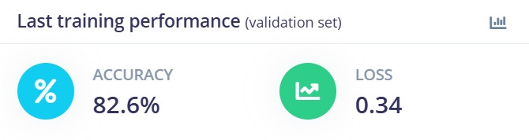 <em>Fig. 4. Resultados de la validación interna del modelo Float32.</em>

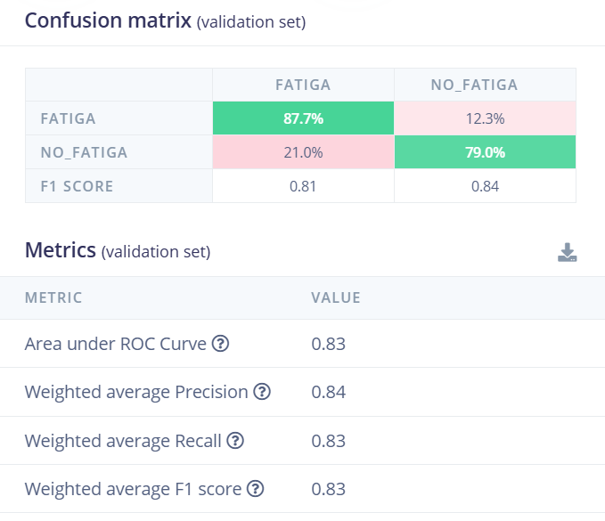 <em>Fig. 5. Métricas y matriz de confusión del modelo Float32 en validación interna.</em>

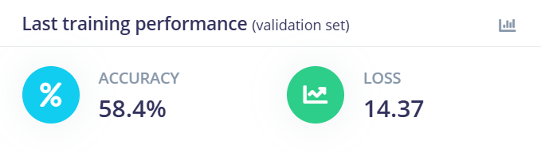 <em>Fig. 6. Resultados de la validación interna del modelo INT8.</em>

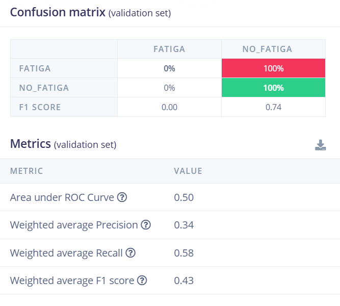 <em>Fig. 7. Métricas y matriz de confusión del modelo INT8 en validación interna.</em>

### 3.2 Prueba independiente (Model Testing)

| Clase real / predicha | Fatiga | No fatiga | Incierto | Total |
|---|---:|---:|---:|---:|
| Fatiga | 44 (68.8 %) | 7 (10.9 %) | 13 (20.3 %) | 64 |
| No fatiga | 56 (62.9 %) | 9 (10.1 %) | 24 (27.0 %) | 89 |
| Total | 100 | 16 | 37 | 153 |

Los conteos se reconstruyeron a partir de los porcentajes de Edge Impulse y los totales de cada clase. Se obtuvieron 53 aciertos de 153 registros (34.64 %), 63 clasificaciones incorrectas entre las dos clases y 37 predicciones inciertas (24.18 %).

| Clase | Precisión calculada | Recall calculado | F1 mostrado |
|---|---:|---:|---:|
| Fatiga | 44.00 % | 68.75 % | 0.54 |
| No fatiga | 56.25 % | 10.11 % | 0.17 |

La exactitud balanceada calculada con los conteos exactos es 39.43 % (39.45 % si se utilizan los porcentajes redondeados de la matriz). El recall ponderado mostrado por la plataforma es 0.46, distinto del recall ponderado calculado con las 153 muestras y las predicciones inciertas como errores (53/153 = 0.3464). Se conservan ambos resultados con sus respectivas definiciones; el tratamiento interno de las predicciones inciertas en las métricas de la plataforma no se pudo verificar.

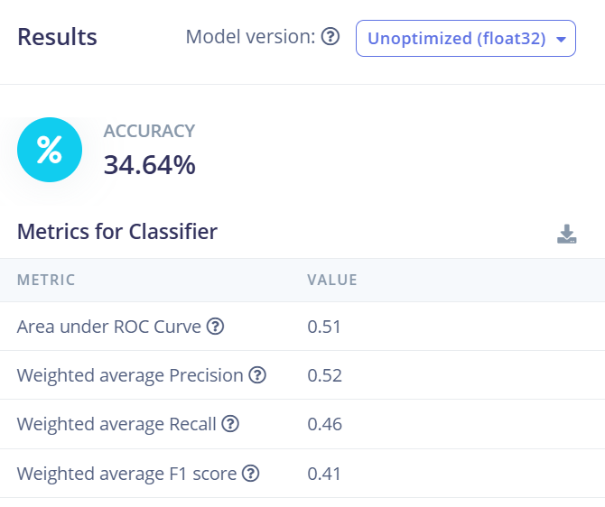 <em>Fig. 8. Resultados y métricas del conjunto de prueba independiente.</em>

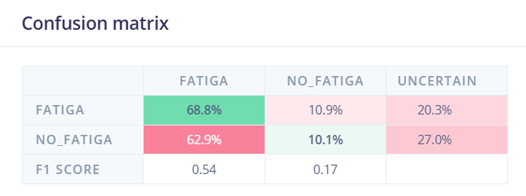 <em>Fig. 9. Matriz de confusión de la prueba independiente, incluyendo predicciones inciertas.</em>

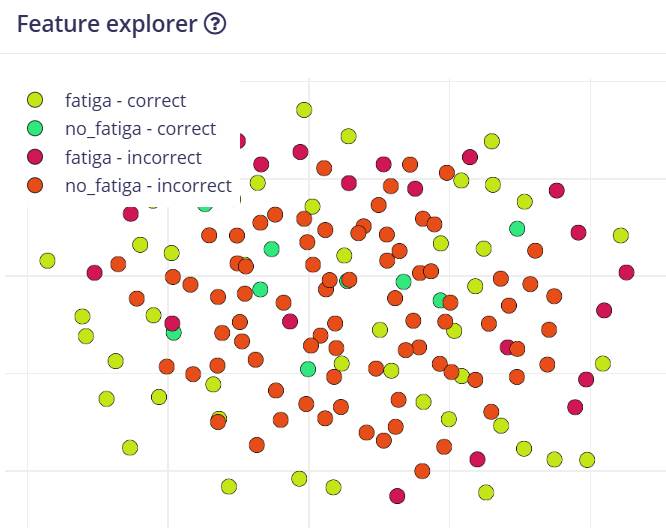 <em>Fig. 10. Distribución de las muestras de prueba en el Feature explorer.</em>

### 3.3 Desempeño estimado en el dispositivo objetivo

| Indicador | Float32 | INT8 |
|---|---:|---:|
| Latencia | 3044 ms | 671 ms |
| RAM pico | 179.3 KB | 58.2 KB |
| Flash | 109.0 KB | 73.7 KB |

La cuantización redujo el uso estimado de memoria y la latencia, pero degradó el desempeño de clasificación. Float32 supera los presupuestos configurados de RAM (128 KB) y latencia (100 ms); INT8 también supera el presupuesto de latencia. Son estimaciones de la plataforma, no mediciones físicas en el dispositivo.

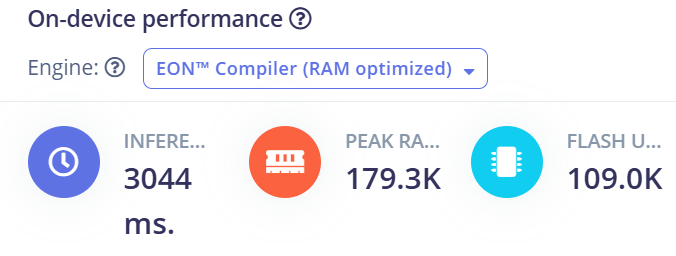 <em>Fig. 11. Latencia y consumo estimado del modelo Float32 en el dispositivo objetivo.</em>

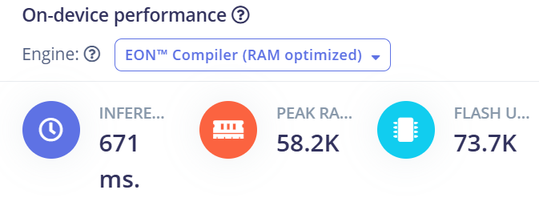 <em>Fig. 12. Latencia y consumo estimado del modelo INT8 en el dispositivo objetivo.</em>

## 4. Interpretación y limitaciones

El conjunto de prueba permite evaluar la transferencia desde Cerqueira hacia una adquisición independiente con BITalino. Un resultado modesto podría estar asociado a diferencias de instrumentación, colocación de electrodos, intensidad del ejercicio y criterio de etiquetado. La CNN de la guía recibe cada ventana de forma aislada y carece de una referencia individual de las primeras repeticiones. Esto limita su capacidad para medir cambios relativos de una persona a lo largo de la serie.

Los 153 registros corresponden a cuatro sujetos y, por tanto, las repeticiones de una misma persona comparten condiciones de adquisición. S02 aporta solo dos repeticiones con fatiga, frente a entre 20 y 21 para cada uno de los otros tres sujetos. Una validación interna que distribuya repeticiones del mismo sujeto entre entrenamiento y validación puede sobreestimar la generalización. La evaluación independiente en Testing tiene mayor peso para interpretar el desempeño.

## 5. Conclusiones

La CNN 1D permitió distinguir ambas clases durante la validación interna, con una exactitud de 82.6 % en Float32. Sin embargo, al evaluar los registros independientes de BITalino, la exactitud disminuyó a 34.64 % y el AUC fue de 0.51. La clase no fatiga presentó el menor recall (10.1 %), y 37 registros quedaron sin una decisión de clase. La exactitud balanceada de la prueba (39.43 % considerando las predicciones inciertas como errores) fue inferior a la referencia de la clase mayoritaria (50 %) y a los valores reportados previamente en Python para CNN (54 %) y LDA con características relativas (71 %). La comparación debe considerar las posibles diferencias en los protocolos de decisión. Los resultados no sustentan el uso de esta CNN como detector confiable de fatiga en sujetos nuevos. Se recomienda explorar características relativas a cada sujeto, validación agrupada por persona y estrategias de adaptación entre dominios, utilizando datos de desarrollo separados del conjunto de prueba.

